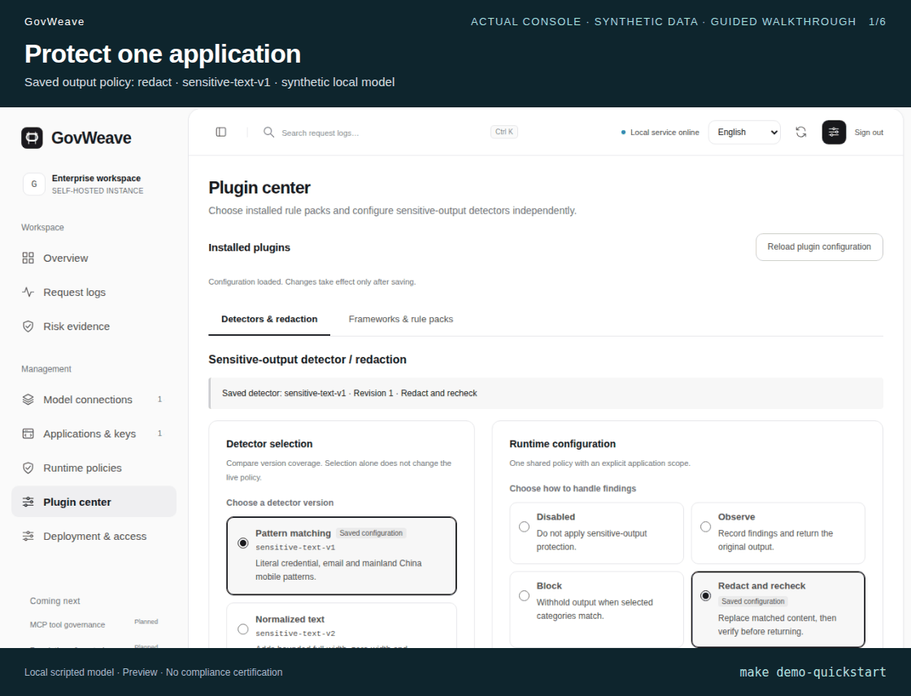
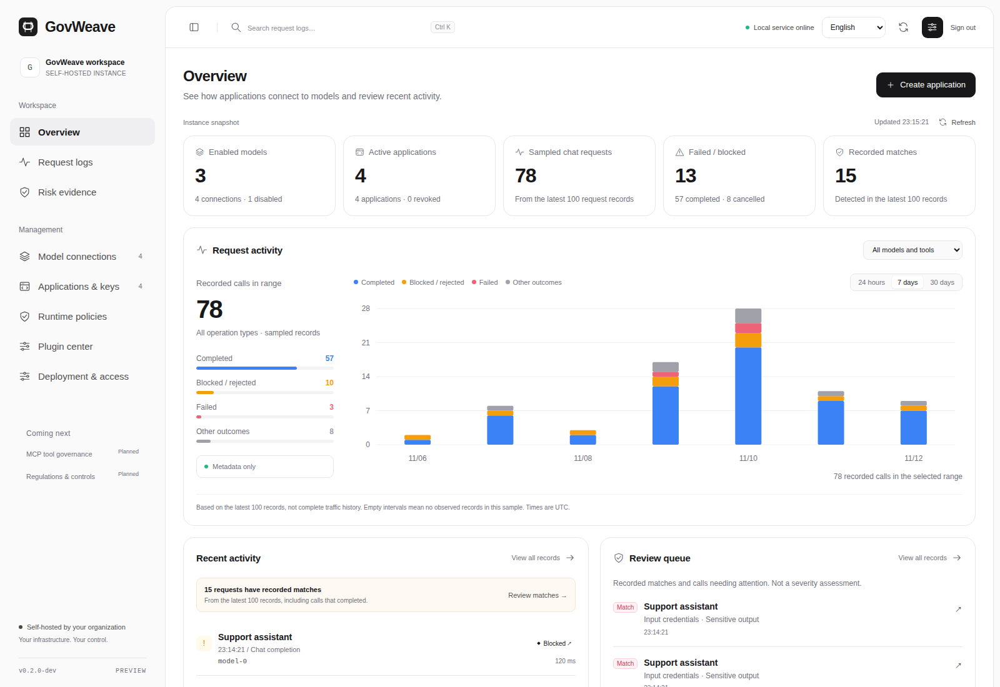
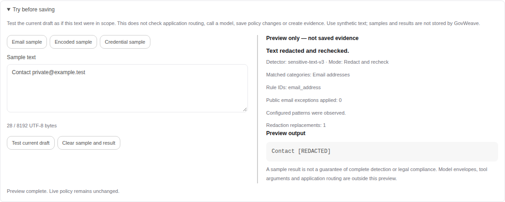
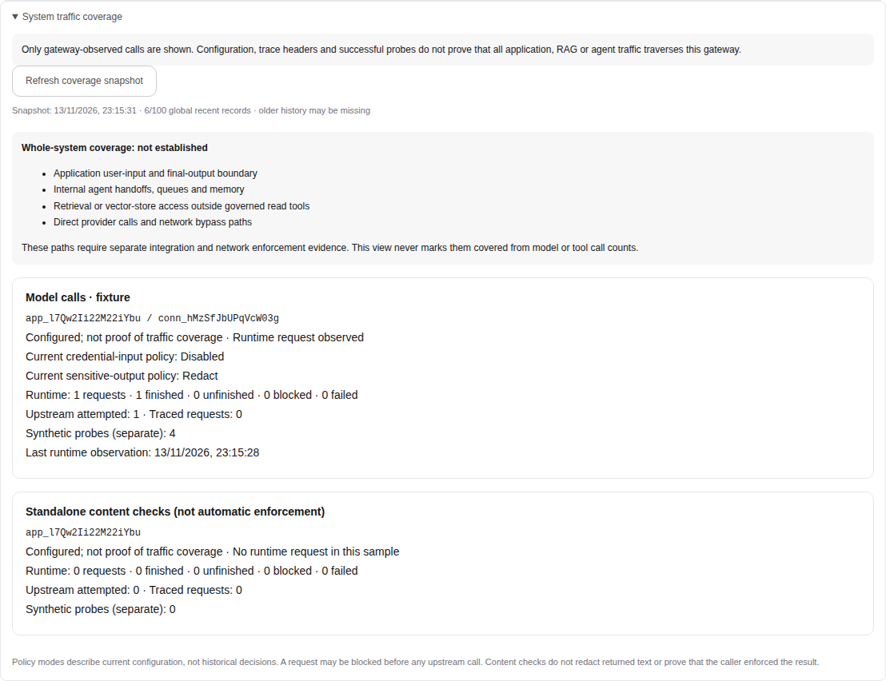

# GovWeave

**English** | [简体中文](README.zh-CN.md)

**Sensitive-output protection, application permissions and traceable audits for AI applications.**

GovWeave is an open-source, self-hosted AI governance gateway for developers building AI support, knowledge assistants and Agent platforms. Connect an OpenAI-compatible model endpoint and keep gateway configuration on your own infrastructure.

**[Try locally — no model account](docs/try-it.md)** · [Watch the 60-second walkthrough](docs/demo/README.md) · [Connect your application](docs/application-onboarding.md) · [EU AI Act / NIST / ISO 42001](docs/framework-workflows.md) · [Documentation](docs/README.md)

- **Control what reaches the application.** Detect supported credential, email and phone patterns; block or redact non-streaming model/tool output within the configured scope.
- **Give each application its own access.** Issue application keys, grant models and authorize integrated read tools.
- **Inspect what happened.** Follow requests to policy revisions and findings; explicitly enable encrypted content capture when you need to compare original and prepared output.

**0.2.0-dev preview · Apache-2.0 · English / 简体中文.** Single-process, single-organization deployment. Technical controls and evidence, not legal compliance certification.

[](docs/demo/README.md)

Actual console, isolated gateway, scripted local model and synthetic data. Six annotated captures, 10 seconds each; [static frames and transcript](docs/demo/README.md). Ordinary audit logs contain metadata only; this demo explicitly enables separate content capture.

## EU AI Act · NIST · ISO/IEC 42001

**Run framework evidence and remediation workflows locally, without a model account.** Select a pinned pack, bind applications, add evidence references in the console, inspect gaps and verify fixes against retained reports.

| Framework | Available workflow |
| --- | --- |
| **EU AI Act** | Selected interaction transparency, high-risk readiness and GPAI evidence drafts |
| **NIST AI RMF / GenAI** | Lifecycle testing and selected GenAI evidence, linked to product reports and remediation |
| **ISO/IEC 42001** | Management-system preparation checklist based on the public overview; no clause-level conformity or certification |

```bash
make demo-frameworks
```

The six-pack synthetic demo verifies **missing evidence → gap → remediation → verification → report replay → stale evidence**. Manual-review items remain unknown. [Framework walkthrough, expected results and console steps](docs/framework-workflows.md). Packs require explicit installation; these are bounded technical/preparation workflows, not complete regulatory coverage.

## Try without a model account

From a source checkout, with **Go 1.24+, Python 3.10+ and Make** installed:

```bash
make demo-quickstart
```

The trial builds an isolated gateway, verifies **normal answer → email redaction → credential input blocked**, checks all three audit records and linked evidence, then removes its temporary services and content. No provider key, model download or paid inference is needed. See [clone instructions, expected output and troubleshooting](docs/try-it.md).

To use your own model, follow [application onboarding](docs/application-onboarding.md). The console defaults to English and remembers an explicit Simplified Chinese selection.

## Screenshots

<details>
<summary>Browse the overview, redaction preview and traffic coverage</summary>

Actual console screenshots from isolated local tests using **synthetic fixtures**, not production traffic or compliance results. [Screenshot sources and refresh instructions](docs/screenshots/README.md).

### Gateway overview

Review request activity and items needing investigation in the English-default console.



### Local redaction preview

Try a detector draft against synthetic text before saving a policy. Previewing does not change live enforcement.



### System traffic coverage

Keep runtime calls separate from assessment probes, and show unverified system boundaries rather than claiming complete coverage.



</details>

## What works today

| Capability | Current behavior |
| --- | --- |
| Model connections | Configure an upstream base URL, credential, model ID, and service alias |
| Application access | Issue, rotate, and revoke application keys; grant access to specific connections |
| Model API | `POST /v1/chat/completions` with JSON or SSE; `GET /v1/models` |
| Read-tool governance | Application/resource grants before execution, bounded credential output checks, configuration history, Python executor example and continuous product evidence; see [integration guide](docs/tool-governance.md) |
| Sensitive output | Version-pinned, bounded credential/email/CN mobile detection, an application evaluation API, and optional non-streaming model/tool blocking or verified redaction; explicit v2/v3 options add limited normalization and encoding checks; see [scope and measurements](docs/sensitive-output.md) |
| Runtime policies | Local credential checks; disabled, observe, or block; immutable configuration history and revision lookup |
| Compliance evaluator | Local rule pack plugins, product profiles, gateway evidence and automatic advisory reassessment |
| Plugin center | Select installed framework/rule-pack versions, bind product applications, configure detectors/redaction, and review control evidence and model-test history; [workflow](docs/plugin-center.md) |
| EU/US starter bundle | Eight pinned, partial draft packs covering EU AI Act preparation, GDPR evidence, NIST profiles, FTC claims evidence and technical output controls; [scope, installation and isolated results](docs/eu-us-compliance-bundle.md) |
| System traffic coverage | Read-only product view of granted routes and bounded observed calls, with assessment probes separate and bypass/application boundaries explicitly unverified; [pilot guide](docs/system-gateway-pilot.md) |
| Report snapshots | Explicit immutable capture, retained rule/evidence inputs, findings and fixed-time replay; numeric runtime facts reference the exact contributing sampled requests |
| Risk remediation | Track failed/unknown product controls, record progress, bind explicit retests and verify against fresh retained assessments; stale evidence remains visible; [workflow](docs/remediation.md) |
| Canary exposure check | Fresh synthetic markers, bounded encoding detection and a frozen-corpus measurement report; see [scope and measured misses](docs/canary-validation.md) and [quality/cost replay](docs/canary-benchmark.md); [detector plugins and routing replay](docs/detector-routing.md) compare fast/deep paths |
| Active assessment | Versioned test suites, pre-deployment runs, opt-in operation retesting and partial NIST AI RMF lifecycle evidence; see [guide](docs/active-assessments.md) |
| Request records | Request ID, authorization, policy revision and matches, execution outcome, and timing; no prompt or response bodies |
| Risk evidence | Explicit application scope, separately encrypted original/prepared content, policy snapshots, detector versions, findings and audited administrator content access; [retention guide](docs/risk-evidence.md) |
| SSE evidence | Separate validated upstream frames and client write attempts; frame timeline, keyed fingerprints, completion/interruption states and bounded retention; [streaming boundaries](docs/risk-evidence.md#streamed-response-evidence) |
| Multi-Agent tracing | Explicit task context across model/tool/content calls, parallel branches, joins and retries; application-isolated queries and administrator-selected aggregation; see [tracing guide](docs/agent-tracing.md) |
| Task call map | Interactive application lanes, declared parent/link/retry references, risk filters, missing evidence and node-to-evidence navigation; [task evidence](docs/risk-evidence.md#cross-application-task-evidence) |
| Task evidence snapshots | Freeze an unchanged task view, reopen historical metadata and export JSON or an English Markdown report; [snapshot guide](docs/risk-evidence.md#task-snapshots-and-report-export) |
| Application output policies | Independent mode, detector, categories and email exceptions per application; default inheritance, history and restore; [policy guide](docs/sensitive-output.md#independent-application-policies) |
| Administration | Initial password setup and authenticated management through the console or built-in `govweave admin` CLI; [terminal guide](docs/admin-cli.md) |
| Languages | English by default, with an offline Simplified Chinese option |
| Distribution | Go binary, locally built container image, and offline archive |

Broad semantic risk detection, streaming output enforcement, MCP tool execution, approval workflows, comprehensive reviewed EU/US regulatory coverage, SSO, and high availability are **not implemented**. See [supported interfaces and limits](docs/model-gateway.md).

## Quick start

Run these commands from the repository root. Building from source requires Go 1.24 or later; this repository's Docker build pins Go 1.26.9. No database, Node runtime, or frontend build is required to run the gateway.

```bash
go run ./cmd/govweave -config examples/deployment.json
```

Open **http://127.0.0.1:8080**. The example configuration stores data in `./data`.

1. Set and confirm the initial administrator password, using 12–128 characters. There is no default password. Complete setup before opening access to other users.
2. Under **Deployment & access**, set the organization name and the root URL applications can reach. For this local setup, use `http://127.0.0.1:8080`.
3. Under **Model connections**, add your provider's base URL, actual model ID, and a service alias such as `internal-assistant`. Supply an upstream key if required. Explicitly allow HTTP only when using an unencrypted provider on a trusted network.
4. Under **Applications & keys**, create an application, select its allowed models, and save the one-time application key.
5. Under **Deployment & access**, select that application to obtain an example with your actual base URL and an authorized alias.
6. Send a request and open **Request logs** to inspect the result. A connection check only reads the upstream model list; it does not test inference.

Alternatively, with Docker and Compose installed:

```bash
docker compose build
docker compose up -d --no-build
```

Compose also publishes http://127.0.0.1:8080 by default. Use one startup method at a time. Its data lives in a named Docker volume, separate from the source-run `./data` directory. See [deployment](docs/deployment.md) for remote access, HTTPS, persistent storage, and offline installation.

## Make an application request

Set the following in the application's environment:

| Variable | Value |
| --- | --- |
| `GOVWEAVE_BASE_URL` | The gateway root URL plus `/v1`, for example `http://127.0.0.1:8080/v1` |
| `GOVWEAVE_API_KEY` | The application's key, not the administrator password or upstream credential |

These are **application-side conventions**, not gateway server configuration variables. The alias below must exist and be granted to the application.

```bash
curl --fail-with-body "${GOVWEAVE_BASE_URL%/}/chat/completions" \
  -H "Authorization: Bearer $GOVWEAVE_API_KEY" \
  -H "Content-Type: application/json" \
  --data '{"model":"internal-assistant","messages":[{"role":"user","content":"Summarize this document."}],"stream":false}'
```

See [application and agent integration](docs/model-gateway.md#application-and-agent-integration) for a Python SDK example, streaming behavior, and the tool execution boundary.

## Configure controls and compliance evidence

Applications and SDKs use **the GovWeave `/v1` base URL, an application key and an authorized model alias**. The upstream provider URL and credential stay in the gateway connection. For example, a SiliconFlow connection uses `https://api.siliconflow.cn/v1`, not `/v1/chat/completions`; a successful `GET /models` check alone does not verify inference.

1. Configure model grants and scoped runtime policies. Input credential blocking and sensitive-output redaction are separate controls; selecting a framework does not enable enforcement.
2. In **Plugin center → Compliance frameworks / rule packs**, select an installed version, create/save a product and bind its applications. Each product currently selects one rule pack.
3. Evaluate the product and inspect each control's evidence, gaps and manual-review requirements. Missing organizational facts remain unresolved, not passed. Archive a report explicitly when retained assessment evidence is needed.
4. Use **Model tests and retained history** for explicit active assessments and opt-in periodic retesting. Ordinary application calls appear in request audit; they do not create active test runs.
5. Refresh **System traffic coverage** to compare configured routes with observations from the global most recent 100 records filtered to the product. This is not a coverage percentage or complete long-term history.

See the [plugin-center guide](docs/plugin-center.md) and [system gateway pilot](docs/system-gateway-pilot.md). Changing a model client's base URL does not route all application ingress/egress, RAG retrieval or agent handoffs through the gateway. Those paths need separate integration and bypass controls. Input protection currently checks credential patterns, not general input-PII redaction.

## Verified formal-gateway smoke test

On **2026-11-13, 23:04:04–23:04:11 Asia/Shanghai (15:04:04–15:04:11 UTC)**, three synthetic, non-streaming application requests traversed the existing Docker-deployed GovWeave instance with SiliconFlow `Qwen/Qwen3.8-27B` configured upstream. Input policy was `block` (revision 2); output policy was `redact` (revision 1), using `sensitive-text-v1`.

| Case | Observed result | Upstream attempted | Client elapsed time |
| --- | --- | --- | --- |
| Benign exact-response request | HTTP 200; expected answer matched | Yes | 2,754 ms |
| Synthetic email echo | HTTP 200; redacted; original marker absent from answer and reasoning | Yes | 3,577 ms |
| Synthetic credential in input | HTTP 403, `policy_blocked`; stopped before provider access | No | 4 ms |

All three application-scoped trace queries returned finished audit records. An earlier run at 22:56 Asia/Shanghai, with input checks disabled and output redaction enabled, also verified synthetic credential **output** redaction. The later input-blocked request has no output to inspect; `output_unavailable` is not evidence of a leak.

A saved product's application binding and `sensitive-output-governance` version `1.1.0` selection were verified. **Administrator assessment report results were not read back**, so these runtime checks do not establish a framework pass. They are ordinary synthetic application calls, not active assessment jobs or verified end-user traffic. Single-request timings are not benchmarks or SLAs; RAG, tool and multi-agent paths were not exercised in this formal run.

Sanitized summaries are documented here; private reports remain under ignored `dist/` (`formal-gateway-smoke-20261113T145606Z.json` and `formal-gateway-smoke-20261113T150404Z.json`) and are not distributed with the repository. Credentials and raw request/response bodies are not included. These results are separate from the [isolated EU/US rule-pack and model trials](docs/eu-us-compliance-bundle.md), and neither constitutes legal compliance certification.

## Inspect risk evidence

Capture starts **disabled**. In the console, open **Risk evidence**, expand the retention settings, explicitly select applications, and choose **Metadata only** or **Full capture**. Existing application requests need no additional capture parameters. New applications are not added automatically.

1. Send an authorized request through the gateway. In **Request logs**, filter detected matches, blocked/rejected calls or failed/unknown checks, and search by application, request/trace ID, model or rule. Counts cover the loaded snapshot and may overlap. Open a request for its check summary, then choose **View retained evidence**; returning restores your filters.
2. Inspect the original input, prepared upstream request, observed upstream output and prepared client output. Available stages depend on how far the call progressed; blocked or redacted output stays distinct from the prepared response.
3. Review the recorded findings, detector/policy versions and retained relationship graph. An administrator can request a content preview and then the original text; each content access is recorded before release.
4. For SSE, expand the frame timeline to inspect offsets, sizes, observation times and the termination reason. `stream_incomplete` distinguishes an unfinished stream from an actual write/flush failure.
5. Use **Task evidence across applications** to join retained captures and recent audit records for a trace across 1–16 explicitly selected applications. Inspect parent/join/retry references and distinguish missing, unreadable and budget-excluded captures; see [task evidence](docs/risk-evidence.md#cross-application-task-evidence).
6. Save the reviewed task view as a snapshot, reopen it with the exact application scope, and export JSON or a Markdown report. Historical evidence states remain frozen independently of content expiry; [snapshot limits](docs/risk-evidence.md#task-snapshots-and-report-export) apply.

The default retention is **30 days and 64 KiB per object**, configurable to 1–365 days and 4 KiB–1 MiB. Oversized content is omitted in full; counts and keyed fingerprints remain. Stream timelines retain the first **128 frames** with an explicit truncation flag. SSE evidence covers validated frames and write attempts, excludes invalid/error-frame contents, and does not prove client receipt. Capture is published after terminal audit; a process crash can lose in-flight evidence.

**SSE evidence capture does not enable streaming safety enforcement.** In-scope output protection still rejects SSE before provider I/O. Individual capture graphs stay within one application; the separate task view requires explicit administrator-selected applications. Declared Agent links are not verified causality. Product report samples remain available independently of body capture and do not establish complete product-wide coverage. See the [risk evidence guide](docs/risk-evidence.md) for limits, missing-evidence states and recovery.

## Request protection and data handling

In **Runtime policies**, configure the built-in credential egress policy. It starts **disabled**. **Observe** records matching rule IDs and forwards the request, including matched credentials. **Block** rejects matching requests before contacting the model provider. Both application and model scopes must match.

Checks run locally. Ordinary audit records exclude prompts, responses, matched secrets, and raw upstream errors. Explicit full evidence capture can retain sensitive request/response bodies in a separate AES-256-GCM vault; it does not copy them into ordinary logs, graphs or reports. Configuration and records stay in your data directory; allowed requests are sent to the model provider you configure. Self-hosting the gateway does not make a cloud model local.

Upstream credentials are encrypted with a local key; application keys are stored as hashes and identifying prefixes. The current record store is not tamper-evident. A rule match or lack of matches is not a legal compliance determination. Read [runtime policies](docs/runtime-policies.md) before enabling enforcement. The [generic evaluator](docs/compliance-engine.md) accepts local rule packs; a narrow [EU interaction-transparency draft](docs/eu-transparency-reports.md) is available, but no expert-reviewed regulatory pack is bundled. [Registered products](docs/product-assessments.md) can track gateway configuration and sampled call metadata; independently verified product-wide evidence is not collected.

Evidence ciphertext authentication does not establish a complete forensic chain or external tamper-proof attestation. Stop the instance before backing up its entire private data directory, including `evidence.key` and `evidence/`, together; see [backup and recovery](docs/risk-evidence.md#storage-retention-and-recovery).

## Examples and local trials

Run `make demo-support-agent` to try a separate file-backed customer-support application through the gateway. The nine-case local trial retains the known hexadecimal miss and includes paired local read timing; a separate three-case Kimi trial is documented in the [developer trial guide](docs/support-agent-trial.md).

Run `make demo-multi-agent-trace` for a local Python/Node example with separate application keys, concurrent workers, a join and a denied retry. It checks five gateway calls and scoped trace queries without a model account. The trace shows observed calls and declared relationships; it does not determine task completion. See [heterogeneous Agent tracing](docs/agent-tracing.md).

The optional [real-framework trace trial](docs/framework-tracing-trial.md) runs pinned LangGraph and Pydantic AI packages with a serialized asynchronous handoff. It verifies concurrent tasks, timeouts, explicit retries, cancellation and unknown references against local services; deterministic model decisions make faults reproducible. Framework dependencies stay in a separate Python environment.

Run `make demo-sensitive` for local model-output enforcement checks, and `make validate-sensitive` for frozen detector measurements. An explicit `python3 scripts/demo-sensitive.py --kimi` performs three synthetic requests to the domestic Moonshot API using a hidden key prompt. See [sensitive output](docs/sensitive-output.md).

Run `make demo-output-governance` to connect model/tool protection to eight technical controls, automatic assessment and 11 retained report snapshots. It uses local synthetic services and checks that restoring protection preserves earlier evidence gaps. See [the sensitive-output rule pack](docs/sensitive-output-governance.md).

Run `make demo-output-assessment` to verify three sensitive-output challenges and a benign control, and connect current pre-deployment/operation results to product reports. See [active output-control assessment](docs/output-control-assessments.md).

Run `make demo-tool-assessment` to verify sensitive read-tool output, denied resources and current product evidence. See [active read-tool assessment](docs/tool-control-assessments.md).

Run `make demo-application-assessment` to combine independent model and tool tests in one product report. See [combined application assessment](docs/application-assessments.md).

Run `make evaluate-agent` to exercise a model → read tool → answer loop against fixed benign/attack scenarios and retain metadata-only task reports. The default uses a scripted local model; a separate bounded Moonshot K2.6 run completed seven cases under v2 plus document review, with three of four attack controls passing and two of three normal tasks completing. Live mode is explicit; the known failures remain documented. See [knowledge Agent evaluation](docs/knowledge-agent.md).

Use `make evaluate-agent-controls` for the opt-in tool-instruction and exact public-email comparison; reported limits include indirect/encoded misses and quoted-training false blocks.

Use `make evaluate-agent-reviews` to compare instruction v1, v2 and exact resource-document reviews separately; reviewed permissions preserve selected fixed training documents without granting access or waiving other output controls.

Use `make accept-agent` for a bounded three-profile local acceptance run with complete planned denominators, audited gateway attribution, and a separate explicit Moonshot preflight. Execution completion does not imply all controls passed; encoded leakage remains a measured miss. See the [acceptance guide](docs/knowledge-agent.md#bounded-acceptance-across-three-profiles).

Opt in to `sensitive-text-v3` for bounded paired email formatting and single-layer Base64 detection. `make validate-sensitive-v3` preserves unsupported-form misses and encoding-limit unknowns; the [v3 guide](docs/sensitive-output.md#explicit-v3-formatted-email-boundaries-and-single-layer-base64) documents scope and measured tradeoffs.

Run `make demo-agent` for a Python executor integration with continuous rule-pack evaluation and replayable reports. Its proposals and read service are scripted; no model account is needed. `make demo-tools` separately exercises permitted access, denial before execution, and credential output blocking through the raw API. See [read-tool integration](docs/tool-governance.md).

No model or test application yet? Run `make demo` for an isolated local support fixture and the normal → fault → repair assessment flow. See [Local demonstration](docs/local-demonstration.md); it requires Python 3 and no provider account.

## Documentation

- [Documentation index](docs/README.md)
- [Deployment, backup, recovery, and troubleshooting](docs/deployment.md)
- [Model API, application integration, and request records](docs/model-gateway.md)
- [Runtime policy configuration and detection limits](docs/runtime-policies.md)
- [Risk evidence, SSE capture and content-access auditing](docs/risk-evidence.md)
- [Multi-Agent tracing and relationship boundaries](docs/agent-tracing.md)
- [Product assessments and report evidence](docs/product-assessments.md)
- [Plugin center and configuration workflow](docs/plugin-center.md)
- [EU/US starter packs and isolated test results](docs/eu-us-compliance-bundle.md)
- [System gateway coverage and traced knowledge pilot](docs/system-gateway-pilot.md)
- [Development and verification](docs/development.md)
- [Architecture decisions](docs/README.md#architecture-decisions)
- [OpenAPI contract](api/openapi.yaml) and [JSON schemas](schemas/)

## Development

```bash
make test
make check
make build
make package
```

`make test` runs Go's race detector and needs a C compiler and permission to listen on local test ports. `make check` also needs Node for JavaScript validation. Browser, SDK, and container tests are documented separately; their dependencies are development-only.

After `make build`, run `node tests/evidence-smoke.cjs` with the [documented Playwright/Chrome setup](docs/development.md#browser-verification) to check capture, original blocked output, privileged content access, report replay, normal/interrupted SSE, retention limits and restart persistence. It uses isolated local synthetic services; no model API key is required.

English is the default documentation language. Chinese documentation lives in `README.zh-CN.md` and `docs/zh-CN/`. Keep examples and capability statements consistent with the code and API contracts.

Run `make benchmark-gateway` for [synthetic end-to-end gateway load measurements](docs/gateway-benchmark.md): direct-provider comparisons, JSON/SSE, evidence capture modes, and separate gateway CPU/heap/GC counters. It uses local fixtures and produces private reports; results are not production capacity or SLA claims.

## License

[Apache-2.0](LICENSE). Distribution dependency notices are in [THIRD_PARTY_NOTICES](THIRD_PARTY_NOTICES).
