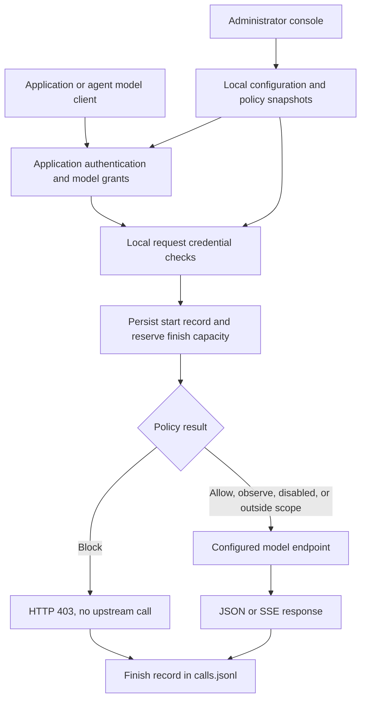

# GovWeave documentation

**English** | [简体中文](zh-CN/README.md)

These guides describe **0.2.0-dev**, the implemented single-instance gateway. Start with the [project README](../README.md) for installation and a first request.

## Choose a guide

| Task | Guide |
| --- | --- |
| Connect your own application with a base URL, application key and model alias | [Application onboarding](application-onboarding.md) |
| Retain encrypted risk evidence, review original/processed output and inspect evidence relationships | [Risk evidence](risk-evidence.md) |
| Inspect sensitive text and protect non-streaming model/tool output | [Sensitive output](sensitive-output.md) |
| Assess output protection using runtime evidence and retained reports | [Sensitive-output technical-control pack](sensitive-output-governance.md) |
| Verify planned model output controls before deployment and during operation | [Active output-control assessment](output-control-assessments.md) |
| Verify read-tool output protection and resource denial in both lifecycle phases | [Active read-tool assessment](tool-control-assessments.md) |
| Assess one product with independent model and tool plans | [Combined application assessment](application-assessments.md) |
| Run bounded knowledge Agent trajectories and compare attack/utility outcomes | [Knowledge Agent evaluation](knowledge-agent.md) |
| Try a separate support application with replaceable knowledge files and local read timing | [Independent support Agent trial](support-agent-trial.md) |
| Trace heterogeneous Agent calls, parallel branches, joins and retries with scoped access | [Heterogeneous Agent tracing](agent-tracing.md) |
| Verify real LangGraph/Pydantic AI handoffs, cancellation and missing receipts | [Real-framework trace trial](framework-tracing-trial.md) |
| Measure known-marker exposure detection and inspect missed cases | [Canary validation](canary-validation.md) |
| Compare detector stage quality and local call latency | [Canary benchmark](canary-benchmark.md) |
| Extend text detectors and validate fast/deep routing | [Detector plugins and routing](detector-routing.md) |
| Try assessment without a real model or application | [Local demonstration](local-demonstration.md) |
| Deploy a binary or container; configure URLs and HTTPS | [Deployment](deployment.md) |
| Back up data, recover access, or diagnose a failed request | [Operations and troubleshooting](deployment.md#troubleshooting) |
| Govern an application/Agent read tool, integrate the Python executor and evaluate its evidence | [Read-tool governance](tool-governance.md) |
| Connect an application or an agent's model client | [Model gateway](model-gateway.md) |
| Understand streaming, errors, records, and capacity limits | [Model gateway](model-gateway.md#streaming-timeouts-and-errors) |
| Configure request credential detection and inspect matches | [Runtime policies](runtime-policies.md) |
| Install declarative rule packs and evaluate product evidence | [Compliance engine](compliance-engine.md) |
| Register products and automatically assess gateway evidence | [Product assessments](product-assessments.md) |
| Review the EU transparency draft and retain/replay reports | [EU draft and report snapshots](eu-transparency-reports.md) |
| Run pre-deployment and periodic operation tests; inspect NIST lifecycle evidence | [Active assessment](active-assessments.md) |
| Build, test, or change the console | [Development](development.md) |
| Automate management or inspect payload definitions | [OpenAPI](../api/openapi.yaml) and [schemas](../schemas/) |

## How the implemented gateway works

Authentication, validation, concurrency, or logging failures can also stop a request before upstream I/O. The diagram shows the accepted model request path. The request credential policy does not inspect responses. Optional [sensitive output protection](sensitive-output.md) buffers and checks complete non-streaming text before durable audit and release; protected streaming is rejected before provider I/O. The diagram above describes the default disabled output policy. The separate [read-tool path](tool-governance.md) checks resource grants before execution and credential patterns before releasing text. A configured model can be local or remote.

The control plane and request path currently run in one Go process. State is stored in private local files; no PostgreSQL, external policy engine, cloud control service, or telemetry collector is required. Files are protected by a single-instance process lock, not a distributed lock.

## Architecture decisions

| Decision | Scope |
| --- | --- |
| [ADR 0001](adr/0001-gateway-first.md) | Self-hosted gateway foundation; historical authentication and Go baseline are superseded |
| [ADR 0002](adr/0002-model-gateway.md) | Model adapter, application keys, streaming, and durable call records |
| [ADR 0003](adr/0003-password-login.md) | Initial administrator password and browser sessions |
| [ADR 0004](adr/0004-request-credential-policy.md) | Local credential detection before model execution |
| [ADR 0005](adr/0005-policy-history.md) | Atomic immutable credential policy history and request attribution |
| [ADR 0006](adr/0006-declarative-compliance-engine.md) | Independent technical evaluator with declarative rule pack plugins |
| [ADR 0007](adr/0007-product-evidence-assessments.md) | Product profiles, gateway-owned evidence and automatic reassessment |
| [ADR 0008](adr/0008-regulatory-draft-report-snapshots.md) | Source-backed draft, manual findings and retained report inputs |
| [ADR 0009](adr/0009-active-lifecycle-testing.md) | Active testing, opt-in scheduling and partial NIST lifecycle support |
| [ADR 0010](adr/0010-scoped-risk-evidence.md) | Explicitly scoped encrypted content evidence and retained runtime references |

The [original Chinese design draft](zh-CN/archive/initial-design.md) is archived for context. Its Eval-first roadmap, assumed existing GRC product, and proposed Python/TypeScript architecture do not describe this implementation.

[Contributor and coding agent guide](../agent.md)

## Planned work

MCP execution controls, approval workflows, broader detection, connection/application configuration history, and human-reviewed EU/US regulatory mappings remain future work. There is no delivery date or legal coverage claim attached to this list. See the individual guides for the narrower boundaries of each implemented feature.

## Documentation conventions

Unqualified filenames are the English source of truth; Chinese translations live under `zh-CN/`. Language links are provided at the top of each guide. Translations must preserve API identifiers, modes, version numbers, and limitations. The archived draft is historical and is not maintained as a current translation.

Examples use loopback URLs for local testing and `.example` or `example.com` names for placeholders. Replace those names with your actual deployment address; the software does not provision a domain, certificate, or upstream model.
