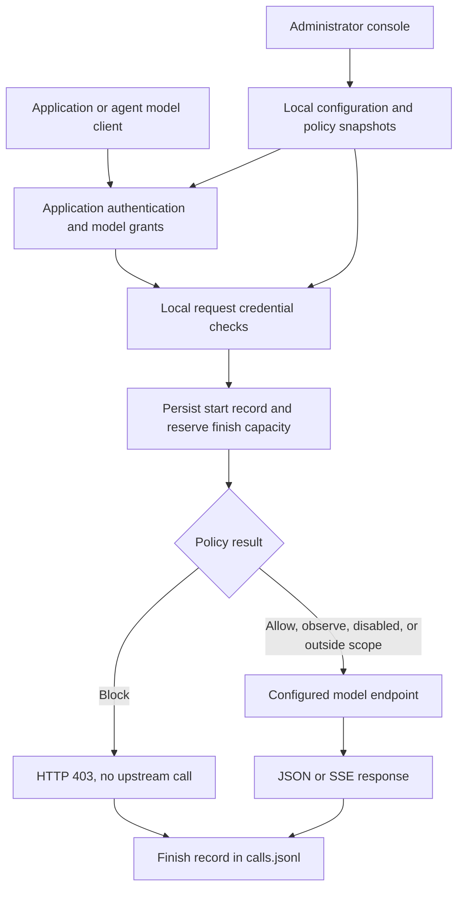

# GovWeave documentation

**English** | [简体中文](zh-CN/README.md)

These guides describe **0.2.0-dev**, the implemented single-instance gateway. Start with the [project README](../README.md) for installation and a first request.

## Choose a guide

| Task | Guide |
| --- | --- |
| Deploy a binary or container; configure URLs and HTTPS | [Deployment](deployment.md) |
| Back up data, recover access, or diagnose a failed request | [Operations and troubleshooting](deployment.md#troubleshooting) |
| Connect an application or an agent's model client | [Model gateway](model-gateway.md) |
| Understand streaming, errors, records, and capacity limits | [Model gateway](model-gateway.md#streaming-timeouts-and-errors) |
| Configure request credential detection and inspect matches | [Runtime policies](runtime-policies.md) |
| Build, test, or change the console | [Development](development.md) |
| Automate management or inspect payload definitions | [OpenAPI](../api/openapi.yaml) and [schemas](../schemas/) |

## How the implemented gateway works

Authentication, validation, concurrency, or logging failures can also stop a request before upstream I/O. The diagram shows the accepted request path. Response bodies are forwarded but are not inspected by the credential policy. A configured model can be local or remote.

The control plane and request path currently run in one Go process. State is stored in private local files; no PostgreSQL, external policy engine, cloud control service, or telemetry collector is required. Files are protected by a single-instance process lock, not a distributed lock.

## Architecture decisions

| Decision | Scope |
| --- | --- |
| [ADR 0001](adr/0001-gateway-first.md) | Self-hosted gateway foundation; historical authentication and Go baseline are superseded |
| [ADR 0002](adr/0002-model-gateway.md) | Model adapter, application keys, streaming, and durable call records |
| [ADR 0003](adr/0003-password-login.md) | Initial administrator password and browser sessions |
| [ADR 0004](adr/0004-request-credential-policy.md) | Local credential detection before model execution |

The [original Chinese design draft](zh-CN/archive/initial-design.md) is archived for context. Its Eval-first roadmap, assumed existing GRC product, and proposed Python/TypeScript architecture do not describe this implementation.

[Contributor and coding agent guide](../agent.md)

## Planned work

MCP execution controls, approval workflows, broader detection, complete policy history, and human-reviewed EU/US regulatory mappings remain future work. There is no delivery date or legal coverage claim attached to this list. See the individual guides for the narrower boundaries of each implemented feature.

## Documentation conventions

Unqualified filenames are the English source of truth; Chinese translations live under `zh-CN/`. Language links are provided at the top of each guide. Translations must preserve API identifiers, modes, version numbers, and limitations. The archived draft is historical and is not maintained as a current translation.

Examples use loopback URLs for local testing and `.example` or `example.com` names for placeholders. Replace those names with your actual deployment address; the software does not provision a domain, certificate, or upstream model.
