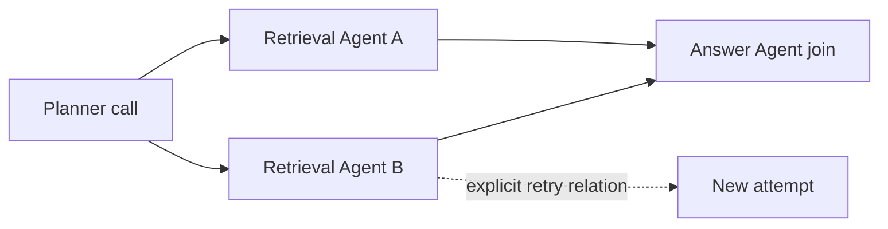

# Heterogeneous Agent tracing

**English** | [简体中文](zh-CN/agent-tracing.md)

GovWeave associates model calls, read-tool calls and independent content evaluations with an application-scoped trace. Different Agent frameworks, languages and services can carry the same correlation ID without sharing model credentials or resource grants. A trace is a graph of observed gateway calls, not an Agent execution engine or proof that a business task completed correctly.

The application API returns only the authenticated application's fragment. An administrator can explicitly select participating applications for a combined view. Merely knowing a trace ID, or sending the same ID as another application, never authorizes access to its records.

For investigation with retained captures, the separate [cross-application task evidence view](risk-evidence.md#cross-application-task-evidence) joins encrypted-vault metadata with recent audit calls. It shows evidence availability and recorded findings while preserving explicit administrator-selected scope and incomplete-history boundaries.

## Correlation headers

The opt-in contract uses these HTTP request headers on `POST /v1/chat/completions`, `POST /v1/tools/{alias}/invoke` and `POST /v1/content/evaluations`. All identifiers must be lowercase, nonzero hexadecimal; do not put names, content or secrets into them.

| Header | Value and purpose |
| --- | --- |
| `X-GovWeave-Trace-ID` | 32 hex characters identifying the caller's task correlation. Required when any auxiliary header is supplied. |
| `X-GovWeave-Parent-Span-ID` | Optional 16-character primary predecessor reference. |
| `X-GovWeave-Agent-ID` | Optional 16-character Agent label declared by the caller; it is not an authenticated identity. |
| `X-GovWeave-Link-Span-IDs` | Optional comma-separated list, without spaces, of up to four distinct 16-character references, for joins or other dependencies. |
| `X-GovWeave-Retry-Of` | Optional 16-character reference to an earlier attempt. It does not request an automatic retry. |

Duplicate headers, malformed values, all-zero IDs and auxiliary fields without a trace ID return `400 invalid_trace_context`. A request must not supply `X-GovWeave-Span-ID`, which is reserved for the server response. Requests without these headers retain their existing behavior. The gateway does not forward the headers to model or tool providers. Their values cannot change application authentication, grants, policy scope, audit admission or output release checks.

If the server cannot allocate a span identifier, the call fails with `503 trace_unavailable` before upstream execution.

For each correlated gateway call, the server generates a new `span_id` and returns `X-GovWeave-Trace-ID` and `X-GovWeave-Span-ID`. The caller can carry the returned span ID into a subsequent parent, join or retry reference. The persisted `CallRecord.trace` uses version `agent-trace-v1` and contains `trace_id`, `span_id`, and any declared `parent_span_id`, `agent_id`, `links` and `retry_of_span_id`. The gateway verifies the calling application and observes the call's execution and policy result. It does not independently verify the claimed Agent identity or causal relationships.

Returned identifiers indicate that correlation was allocated; they do not guarantee that a terminal audit record was durably written or that the whole task completed. On failure, inspect the request outcome and visible audit records.

The 32/16-character identifier sizes are informed by the [W3C Trace Context identifier definitions](https://www.w3.org/TR/trace-context/#traceparent-header-field-values). These are GovWeave-specific headers and validation rules, not an implementation of the W3C `traceparent`/`tracestate` protocol or an OpenTelemetry exporter.

## Parallel work, handoffs and retries

An orchestrator creates one random trace ID before starting a task and passes it explicitly to participating backends. Each backend retains its own application key. The Agent label may distinguish planner, retrieval and answer workers without granting any of them another worker's access.



Use the primary parent for the main predecessor and `links` for additional dependencies. Parallel calls have different server span IDs even when they share a parent. A retry is a new HTTP call and a new span; `retry_of_span_id` preserves the relationship to the previous attempt rather than overwriting it. The gateway does not retry calls or coordinate Agent scheduling.

Only calls that traverse this gateway appear as nodes. Local reasoning, framework-internal steps, queue delivery and calls made outside GovWeave are not uploaded or inferred. A reference to such a step can remain unresolved. Arrival order and wall-clock timestamps do not establish causality between independent services.

## Opt in the Python reference clients

Make `examples/python` importable, for example with `PYTHONPATH=examples/python`. For an already configured HTTPS gateway, set `GOVWEAVE_ROOT` to the instance root without `/v1`, `GOVWEAVE_API_KEY` to the application's key, and `GOVWEAVE_TOOL_ALIAS` to an authorized read tool. A single traced call uses an immutable, explicit context:

```python
import os
from govweave_tools import GovernedToolClient
from govweave_tracing import TraceContext, invoke_traced_tool

root = os.environ["GOVWEAVE_ROOT"]
key = os.environ["GOVWEAVE_API_KEY"]
tool_alias = os.environ["GOVWEAVE_TOOL_ALIAS"]
client = GovernedToolClient(root, key, tool_alias)
context = TraceContext.new()
outcome = invoke_traced_tool(client, {"resource_id": "public-guide"}, context)
print(outcome.metadata())
```

Use resource IDs configured for your application. `metadata()` excludes returned text; the intended application can use `outcome.text` after checking `outcome.status`. A denied call can still have a server span ID. When `outcome.span_id` is present, `context.after(outcome.span_id)` creates a subsequent context without mutating the original. Pass `links=(span_a, span_b)` for a join or `retry_of_span_id=previous_span` for an explicit retry relationship; neither schedules a request.

The plain [KnowledgeAgent reference](knowledge-agent.md) also has an opt-in wrapper. Using the configured `root`, `key` and `tool_alias` above and an authorized `GOVWEAVE_MODEL_ALIAS`, a separate task can run as follows:

```python
from govweave_agent import KnowledgeAgent
from govweave_tracing import run_traced_agent

agent = KnowledgeAgent(
    root, key, os.environ["GOVWEAVE_MODEL_ALIAS"], tool_alias,
    {"public-guide": "Support hours and account recovery instructions"},
)
result = run_traced_agent(agent, "What are the support hours?", TraceContext.new())
print(result.metadata())
```

`run_traced_agent` accepts only the plain `KnowledgeAgent` class. It copies the reference Agent and tool for each run, then carries response span IDs through that run's sequential model → tool → model calls. Entry `links` and `retry_of_span_id` apply only to the first call; later calls reference their predecessor. Existing `run(question)` and `execute(arguments)` calls remain unchanged. This helper is not a framework plugin or automatic instrumentation for arbitrary Agent subclasses.

`python3 tests/trace-client-test.py` checks this opt-in chain with simulated gateway responses, including stopping after a denied tool call and keeping concurrent runs separate. The cross-process demonstration below exercises the tool path; it does not run a real model → tool → model workflow.

## Application and administrator queries

| Endpoint | Authorization and scope |
| --- | --- |
| `GET /v1/traces/{trace_id}?limit=100` | A current application key; only that application's records. |
| `GET /api/v1/traces/{trace_id}?application_id=A&application_id=B&limit=100` | An administrator session; one to sixteen application IDs must be selected explicitly. |

The record limit is 1–128 and defaults to 100. Administrator application IDs must be distinct and already registered. A revoked or rotated-out application key cannot query traces. Administrator selection is a view operation under administrator authority; it neither grants collaboration rights nor creates a persistent sharing arrangement between applications.

Invalid query fields return `400 invalid_trace_query`; invalid application authentication returns `401`. When no record is visible, the response is always `404 trace_not_found`. It does not distinguish nonexistent traces, records outside the current window, or traces belonging to another application.

Reference resolution uses only records visible in the selected response window. A reference outside that view is unresolved; the query does not look up another application's records to reveal whether the referenced ID exists. Relationships remain `caller_declared` even when both nodes are visible. Matching IDs and resolvable links are not independent evidence that two services cooperated.

Each edge's `source_span_id` is the current call, and `target_span_id` is the referenced predecessor/dependency. `relation` is `parent`, `link` or `retry_of`. `resolution: observed` means exactly one target is in this returned view; `unresolved` means none is visible; `ambiguous` means multiple nodes use that ID. No reference is followed recursively, and the response does not assert that caller-declared relationships form a valid causal DAG.

The response includes the selected `application_ids`, records, relationships and fixed risk observations. Policy versions and request IDs connect those observations to the existing [runtime policy history](runtime-policies.md) and [tool governance evidence](tool-governance.md). Each risk event contains only `request_id`, `span_id`, `control`, `result` and `reason`. Controls are `authorization`, `credential_egress`, `sensitive_output`, `tool_credentials` and `tool_instruction`; the existing policy's result is preserved rather than converted into a new score.

An independent `content.evaluate` record reports a content assessment, not an executed block or completed redaction. Inspect the record's `operation`, outcome and policy fields before interpreting an event as actual runtime protection. Risk observations are not calibrated probabilities or a legal compliance conclusion.

The summary counts returned records only: `completed`, `blocked`, `failed` (including cancelled/rejected calls), `in_progress`, `incomplete`, `redacted`, `unknown_detection`, and unresolved/ambiguous reference counts. `redacted` requires a completed call with the policy result `redacted`. `unknown_detection` counts records with an explicitly unknown evaluated control, including a pending check; it does not count every absent or disabled check. Completed gateway calls do not prove successful business tasks, and these counters are not a risk coverage rate.

## Coverage and retention

The view is reconstructed from the existing **global latest 1,000 request index entries**, shared by every application and operation. It does not scan all historical audit records or allocate a separate window to each trace. The response explicitly reports:

- `coverage: gateway_calls_only` and `task_completion: not_determined`.
- `relationship_source: caller_declared`.
- `history_may_be_truncated: true`, even when the current nodes have no unresolved references.
- `window_saturated`, describing the shared index window, and `result_truncated`, describing the selected response limit.
- `audit_available`, describing whether the audit can currently admit and reserve capacity for new calls. Existing records can still be queried while admission is unavailable.

Started calls, interrupted calls and references outside the returned window must be interpreted with these limits. A query cannot prove that all task steps were reported, and no observed risk does not mean the task was safe. Actual task scoring remains a separate assessment.

Trace metadata is persisted with the existing private audit records and reconstructed on restart within the retained index. No prompts, answers, tool arguments or arbitrary metadata are added. Tracing uses existing durable audit admission and output-release behavior; it does not permit an unrecorded call to proceed silently.

## Run the local heterogeneous example

The example requires Go, Python 3 and Node.js. It starts an isolated gateway and a synthetic local read-tool service; no model API key is needed.

```sh
make demo-multi-agent-trace
```

The script starts separate Python and Node worker processes before awaiting either result. They receive the same trace ID explicitly, use different application keys, and declare a shared parent. A later call links both branches, and a separate request declares a retry of the denied Node call. The example checks:

- Five distinct gateway spans: coordinator, two parallel workers, join and retry.
- Three authorized reads completed and two denied calls stopped before upstream execution. The retry remains denied because tracing does not change grants.
- Application views contain only their own three or two records; the administrator's explicitly selected combined view contains all five.
- A cross-application link stays unresolved in the application's view and resolves in the combined view.
- Cross-application query filters, application-key access to the administrator endpoint and revoked-key queries are rejected.

On success, the script prints a private report path under `dist/multi-agent-trace/`. `report.json` contains call metadata and all three views; `report.md` describes the checks and limits. Use `--output-dir` to choose a new output directory. The [Python context helper](../examples/python/govweave_tracing.py) and [Node worker](../examples/python/multi_agent_trace_worker.cjs) demonstrate explicit propagation without a shared global context.

A local run on 2026-10-29 passed these checks: five spans, three upstream reads, two denials, and application/administrator views of three, two and five records. All three actual response views also passed the trace JSON Schema, including referenced tool/content schemas and timestamp format checks. The generated report records the binary and example-source hashes for that run.

This is a synthetic control and trace integration check. It makes no model request and does not establish model safety, semantic detection accuracy, actual framework compatibility, causal correctness or full-task coverage.

## Current boundaries

The separate [real-framework trial](framework-tracing-trial.md) verifies explicit LangGraph and Pydantic AI adapters, serialized async handoff, concurrent tasks and failure paths. Its local fixed model decisions and tool-call coverage have separate evidence limits from the Python/Node example above.

This version does not provide OTLP ingestion/export, automatic framework instrumentation, cross-instance aggregation, external Agent span uploads, authenticated Agent identities, or proof of task completion. Cross-application combined access remains administrator-only. For metadata contracts see [traces.schema.json](../schemas/traces.schema.json) and the [OpenAPI document](../api/openapi.yaml).
