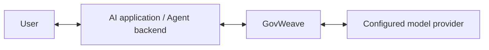

# Connect an application through GovWeave

**English** | [简体中文](zh-CN/application-onboarding.md)

Use GovWeave as the model API entrance for your application backend or Agent. Configure the provider once in the gateway, then give each application its own key and allowed model alias. Requests and responses pass through the gateway's applicable controls.



This guide covers the supported Chat Completions path. Agent tool execution requires [separate tool integration](tool-governance.md); changing a model URL does not govern database, file or tool calls that bypass GovWeave.

## Start the gateway

From the source checkout, with Docker and Compose available:

```sh
docker compose build
docker compose up -d --no-build
```

Open `http://127.0.0.1:8080`. The supplied Compose configuration binds to loopback by default and keeps instance data in a named volume. Create the administrator password on first use. See [deployment](deployment.md) for remote access, HTTPS, backup and recovery; ordinary restart does not require deleting the volume.

In **Deployment & access**, set the root Gateway URL that application backends can reach. The client base URL adds `/v1`. A service running inside another container cannot use its own `127.0.0.1` to reach this gateway; use an address reachable from that service's network. The saved public URL is configuration, not a network connectivity check.

## Configure the model and application

1. In **Model connections**, add the provider base URL, actual provider model ID and provider credential. Assign an application-facing alias, such as `internal-assistant`, and enable the connection. Keep provider paths such as `/v1`; do not append `/chat/completions` to the saved provider base URL.
2. The existing **Check connection** action reads the provider's model list. It does not run inference or verify an application's key.
3. In **Applications & keys**, create an application and grant the model connection. Save the one-time application key in the application's secret store or backend environment.
4. In **Deployment & access**, select that application and an enabled model alias granted to it. Copy the Python or cURL example and the displayed base URL. The examples use non-streaming responses.

The administrator password, application key and provider credential are different identities. Only the application key belongs in the application's `api_key` setting. The provider credential stays in GovWeave, and the administrator session is used only for management.

| Application setting | Value |
| --- | --- |
| `base_url` | Your gateway model URL, for example `https://ai.example.com/v1` |
| `api_key` | The application's GovWeave key |
| `model` | An enabled alias granted to that application |

The `.example` hostname is a placeholder. For a local application on the same host as the sample Compose deployment, use `http://127.0.0.1:8080/v1`.

## Check configuration before inference

The application-authenticated endpoint is:

```text
GET /v1/integration/check?model=internal-assistant
Authorization: Bearer <application-key>
```

It checks local configuration for the supplied key and alias: the authenticated application ID, current model access, audit availability, input/output policy modes, whether each policy applies, and their revisions. It reports whether this path currently permits streaming. Active, scoped output protection requires non-streaming calls.

The response always includes `upstream_contacted: false` and `inference: not_tested`. The check does not contact the model provider, inspect a prompt, append a call audit event or reserve capacity. An HTTP `200` means the local check returned successfully; inspect `audit_available` and the policy fields. Disabled or out-of-scope protection must not be read as an enabled safety control. Configuration can change after the check, and each subsequent call rechecks authorization and applicable policy.

The console compares the returned application ID with the selected application before allowing its verification flow to continue. A valid key for another application is not evidence that the selected application is connected. No other application's details, provider URL or provider credential is returned by this endpoint. See the [integration response schema](../schemas/integration.schema.json) and [OpenAPI contract](../api/openapi.yaml).

## Send one test request and inspect evidence

The console's inference verification is a separate explicit action. It sends one fixed synthetic prompt using the entered application key and selected model alias. This invokes the configured provider and can incur provider charges; there is no automatic inference on page load, application selection or configuration checking, and no automatic retry.

The key entered for verification is temporary. It is not embedded in generated examples or deployment exports, and is not saved in browser storage. Enter it only in the trusted administrator console; application production credentials belong in the backend, not in code delivered to end users.

The browser check uses the current console origin. It does not send the key to an arbitrary saved public URL and cannot prove that a separately deployed application's network can reach that public URL. Run the copied example from the application environment to verify that path.

Inspect the inference outcome, request ID and trace identifiers, then the matching administrator audit record for the selected application. A returned HTTP status or allocated span alone does not prove a committed terminal audit record. A browser timeout or cancellation may occur after the upstream request started; missing response evidence remains unknown and does not prove that the call never executed. Call success also does not establish answer quality, complete Agent-task coverage or legal compliance.

The verifier reports connection and audit metadata rather than retaining the model's answer. **Request logs** and the [trace API](agent-tracing.md) explain observed authorization, policy and execution outcomes. The trace view is limited to gateway-observed calls in the global recent 1,000-request index.

## Use the same settings in application code

Supply these values in the application environment. The variable names are client conventions, not server settings:

```sh
export GOVWEAVE_BASE_URL='http://127.0.0.1:8080/v1'
export GOVWEAVE_MODEL='internal-assistant'
# Inject GOVWEAVE_API_KEY through your backend secret store or environment.
```

With the OpenAI Python client installed in the application's environment:

```python
import os
from openai import OpenAI

client = OpenAI(
    base_url=os.environ["GOVWEAVE_BASE_URL"],
    api_key=os.environ["GOVWEAVE_API_KEY"],
    max_retries=0,
    timeout=30.0,
)
response = client.chat.completions.create(
    model=os.environ["GOVWEAVE_MODEL"],
    messages=[{"role": "user", "content": "Reply with OK."}],
    stream=False,
    max_tokens=16,
)
print(response.choices[0].message.content)
```

This example intentionally displays the returned answer in the application's output. GovWeave's call audit does not store that answer. The console verifier does not display or save model text. For the protocol reference see [Chat Completions](https://developers.openai.com/api/reference/resources/chat/subresources/completions/methods/create); the project's supported subset and provider limitations are documented in [Model gateway](model-gateway.md).

## If a check fails

| Observation | Next action |
| --- | --- |
| Invalid, revoked or rotated-out application key | Supply the current application's key; administrator credentials cannot replace it. |
| Key belongs to another application | Select the intended application or provide its key before inference. |
| Model access denied or connection disabled | Review the alias, application grant and connection status. |
| Audit unavailable | Restore private storage access or address record capacity before new calls. |
| Input/output policy disabled or out of scope | Review the intended protection and scope; successful access does not enable policy. |
| Provider timeout, invalid response or unreachable service | Check the configured upstream and use the request ID to inspect the observed attempt. |
| No matching finished audit record | Keep audit confirmation unknown; refresh the evidence rather than automatically resending inference. |

Configuration checks and one synthetic inference are onboarding evidence. They do not replace [application assessments](application-assessments.md), detector measurements or tests with your application's own scenarios.
