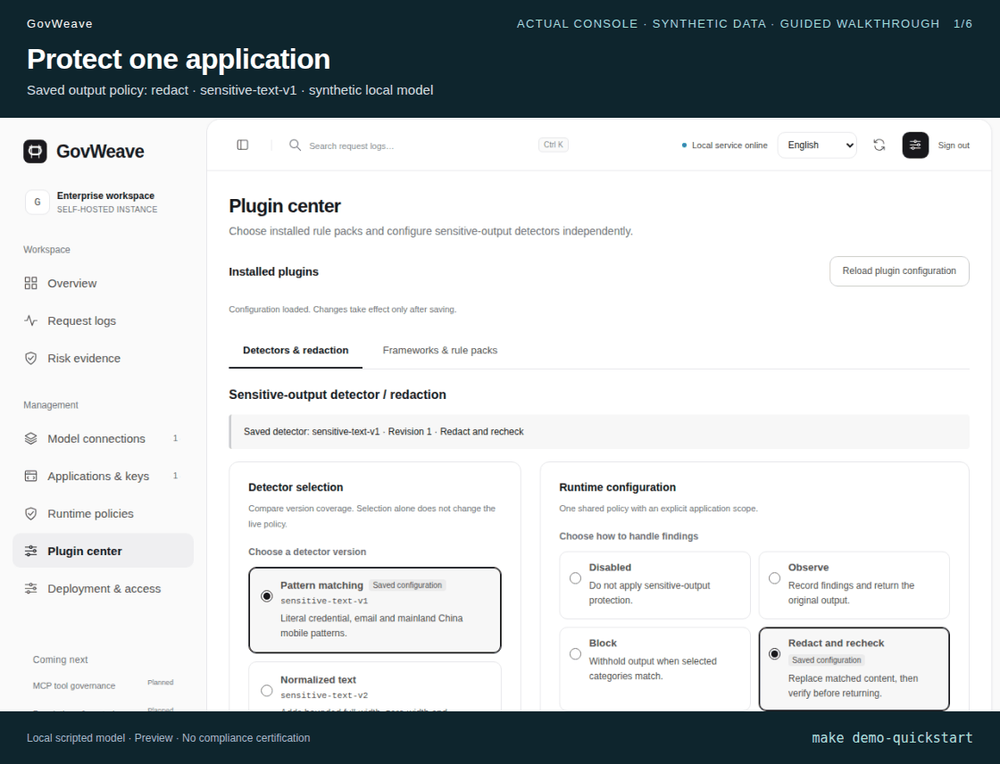

# GovWeave in 60 seconds

**English** | [简体中文](../zh-CN/short-demo.md)

[Run this trial yourself](../try-it.md) · [Connect your application](../application-onboarding.md) · [Project home](../../README.md)



This looping GIF contains six annotated captures of the actual console, shown for 10 seconds each. It is a paced walkthrough, not a real-time recording or a latency measurement. For still images or a text alternative, use the scene links below.

## Scenes and narration

| Time | Static frame | Suggested narration |
| --- | --- | --- |
| 00–10 s | [Protect one application](en-01.png) | “This local gateway has output redaction enabled for one application. It uses a fixed detector version and a scripted model.” |
| 10–20 s | [Three request outcomes](en-02.png) | “A normal answer passes, an email is redacted, and a credential in the input is blocked. Each request has a finished audit record.” |
| 20–30 s | [Inspect the decision](en-03.png) | “Open the email request to see the detection, action and policy revision. From here, follow the link to retained evidence.” |
| 30–40 s | [Original model output](en-04.png) | “Content capture was explicitly enabled for this temporary application. An administrator can review the original synthetic email, with access recorded.” |
| 40–50 s | [Prepared application output](en-05.png) | “The output prepared for the application contains REDACTED in place of the email. The original and prepared output remain separate.” |
| 50–60 s | [Credential blocked before upstream](en-06.png) | “The credential request was blocked before contacting the model. Run make demo-quickstart to reproduce all three cases without a model account.” |

## Source and scope

Captured on **2026-11-14** from the repository's `0.2.0-dev` binary, using [demo-quickstart.py](../../scripts/demo-quickstart.py) and [capture-quickstart.cjs](../../scripts/capture-quickstart.cjs). The console and API responses are real; the model, requests, account names and email are synthetic. The added title/footer live outside the product screenshot. Captures show the three requests after execution; they do not imply that the requests were made by clicking these console pages.

The generator verifies three terminal audit records, two local upstream calls, correct output redaction, input blocking, linked evidence, both UI languages and audited original-content access. The temporary session is destroyed afterward. No real provider account, production traffic or private instance content is used. Normal gateway evidence capture is disabled by default; the demo enables it explicitly in its isolated instance.

These are three non-streaming integration cases, not a safety benchmark, production performance claim or legal compliance assessment. The earlier [screenshot gallery](../screenshots/README.md) has its own sources and is not substituted for these captures.

## Refresh the walkthrough

The normal trial needs only the [quickstart prerequisites](../try-it.md). **Asset generation additionally needs Node, Playwright, Chrome and Python Pillow**, as well as local port/browser permissions. Follow [browser-test setup](../development.md#browser-verification); make Playwright resolvable by Node (for example through your development environment's `NODE_PATH`). `GOVWEAVE_BROWSER_PATH` selects Chrome; the default is `/usr/bin/google-chrome`.

Build the current checkout, then choose a **new** capture directory:

```bash
make build
python3 scripts/demo-quickstart.py --capture-dir dist/quickstart-capture-new
```

This runs the same three-case trial, captures six scenes in each language and creates two 60-second GIFs. Only the capture path is passed on the command line. A disposable admin cookie is sent to the browser helper over stdin; neither it nor application keys are written to the capture directory. A separate private metadata summary remains under `dist/quickstart/`.

Inspect all PNGs and both GIFs before copying the twelve `en-*.png` / `zh-CN-*.png` frames and two `quickstart-*.gif` files into this directory. Update the capture date above and in the Chinese guide. Only reviewed public assets belong here; do not copy raw reports, credentials or instance data.
