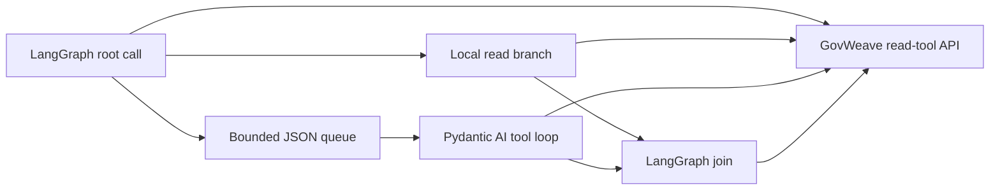

# LangGraph and Pydantic AI tracing trial

**English** | [简体中文](zh-CN/framework-tracing-trial.md)

This optional local trial exercises GovWeave trace propagation through two installed Agent frameworks: LangGraph coordinates work and a Pydantic AI Agent performs a delegated read-tool step. It checks asynchronous handoff, concurrent tasks, explicit retries, deadlines, cancellation and access isolation using an isolated gateway and a controlled local tool service.

The frameworks execute their actual graph and Agent mechanisms. The model decisions are fixed local Python functions, and the message bridge is a bounded JSON queue inside one Python process. This is a framework integration trial, not a real-model evaluation, a distributed message-broker test or a claim of compatibility with every feature of either framework.

## What runs

The [framework adapter](../examples/python/govweave_frameworks.py) uses a compiled LangGraph `StateGraph`: a root call starts two branches, one local and one delegated, then a join records both returned spans. LangGraph's graph API supports this state-and-node composition and asynchronous execution; parallel node completion order does not determine a causal sequence. See the official [graph API overview](https://docs.langchain.com/oss/python/langgraph/graph-api) and [parallel execution guide](https://docs.langchain.com/oss/python/langgraph/use-graph-api#run-graph-nodes-in-parallel).

The delegate uses Pydantic AI's `Agent` and `FunctionModel` to execute a fixed tool-call loop. `FunctionModel` is controlled by a local function; it lets this trial exercise the framework's tool handling without requesting an external LLM. Pydantic's [FunctionModel reference](https://pydantic.dev/docs/ai/api/models/function/) and [testing guide](https://pydantic.dev/docs/ai/guides/testing/) distinguish this kind of control-flow testing from model-quality evaluation.



Each task starts with an explicit immutable trace context. The queue carries bounded identifiers and the selected synthetic resource, not another worker's application key. Each framework uses its own configured application identity. Gateway calls use the existing [tracing headers and query permissions](agent-tracing.md); framework-internal steps and queue operations do not become gateway spans automatically.

The adapter disables its optional framework telemetry and does not checkpoint or cache intermediate graph state. Only the tool HTTP calls traverse GovWeave; the local `FunctionModel` decisions are not model calls through the gateway.

The HTTP path is asynchronous and uses HTTPX directly so task cancellation can close the in-flight connection. Wrapping the synchronous reference client with `asyncio.to_thread` would not establish that behavior: cancelling the waiting coroutine does not stop a running thread. Automatic retry is disabled in the trial's HTTP and framework paths. The one retry scenario is explicit and creates a new gateway span.

## Reproduce the trial

The dependency snapshot uses Python **3.12.9**, `langgraph==1.2.18` and `pydantic-ai-slim==2.63.0`. The [requirements file](../examples/python/framework-trace-requirements.txt) pins the complete resolved dependency set. These are the versions selected for this trial, not a supported-version matrix. Framework packages are optional development dependencies; the Go gateway runtime does not need them.

From the repository root, create an isolated environment and install the pinned packages:

```sh
python3.12 -m venv /tmp/govweave-framework-trace-venv
/tmp/govweave-framework-trace-venv/bin/python -m pip install -r examples/python/framework-trace-requirements.txt
make trial-framework-trace FRAMEWORK_PYTHON=/tmp/govweave-framework-trace-venv/bin/python
```

The make target builds GovWeave and runs [trial-framework-trace.py](../scripts/trial-framework-trace.py); it does not install Python packages. `FRAMEWORK_PYTHON` defaults to `python3`, so select the interpreter containing the pinned dependencies. Package installation may download dependencies; the trial itself uses local services and needs no model API key.

The runner prints a report path under `dist/framework-trace/`. Running the script directly accepts `--binary` for a selected gateway executable and `--output-dir` for a new report directory. It exits zero only when every planned check passes and no fatal failure is recorded; failed or incomplete runs also retain a report when the output directory can be written.

Focused checks for the asynchronous client, framework adapter and trial cleanup are separate from the HTTP integration trial:

```sh
/tmp/govweave-framework-trace-venv/bin/python tests/async-trace-client-test.py
/tmp/govweave-framework-trace-venv/bin/python tests/framework-adapters-test.py
/tmp/govweave-framework-trace-venv/bin/python tests/framework-trial-test.py
```

The trial checks include closing a full queue, cancelling pending submissions, awaiting sibling tasks after a failure, and retaining the planned denominator while withholding unsafe evidence on failed runs.

## Planned checks

The trial keeps a fixed plan so a failure cannot silently shrink the denominator. Its nine scenario groups are:

| Scenario | Required observation |
| --- | --- |
| Normal asynchronous handoff | Actual LangGraph branches and the Pydantic AI delegate share the task trace; the join links their distinct returned spans. |
| Three concurrent tasks | Reusing framework and client objects does not mix trace IDs, receipts or references between the three tasks. |
| Gateway timeout and one explicit retry | The first request receives a gateway timeout; the retry has a new span and a reference to the earlier attempt. Actual tool entries agree with the declared attempts. |
| Client deadline without a receipt | A caller deadline may end before response headers arrive. The report distinguishes the missing client receipt from any subsequently visible gateway record. |
| Cancellation while queued | The cancelled queued work produces no tool I/O. This is an execution-harness observation, not a gateway inference about an unreported step. |
| Cancellation after upstream entry | A fixture barrier first confirms upstream entry, then the caller cancels; the retained gateway record still reports that upstream execution was attempted. |
| Missing parent reference | An absent declared predecessor stays `unresolved`; the response does not manufacture a node or assert complete task coverage. |
| Governance denial | A denied call stops without direct tool fallback or an automatic retry. |
| Query access and revocation | Application queries remain scoped to that application; administrator aggregation requires explicit application selection; a revoked application key cannot query the trace. |

An error, missing observation or unrun check must remain visible in the report's failed/unknown results. A passed timeout or cancellation scenario means the expected failure was observed accurately; it does not mean the interrupted business task succeeded.

## Interpret the evidence

The trial writes metadata reports with directory mode `0700` and file mode `0600`, preserving the plan and passed, failed and unknown counts. Reports include precise package versions and source/binary hashes. Reports must not contain prompts, tool text, credentials, raw exception messages or request bodies. Inspect the per-scenario evidence alongside the aggregate result.

Client cancellation is not rollback. A local service can have received a request before cancellation, and cancellation does not prove that its work stopped or that no side effect occurred. Likewise, a missing response receipt does not establish that the gateway received no request. The fixture's entry barrier and the gateway audit are separate observations.

`parent_span_id` is the primary declared predecessor, `links` describes additional dependencies, and `retry_of_span_id` identifies an earlier attempt. Matching IDs remain caller declarations. Graph state rollback or a framework exception does not erase previously executed HTTP calls or their audit records.

Trace queries retain the gateway's existing limits: the global latest 1,000 request index entries, at most 128 returned records, `coverage: gateway_calls_only`, `relationship_source: caller_declared` and `task_completion: not_determined`. A missing reference is a coverage gap, distinct from `unknown_detection`, which concerns an evaluated detector. Unreported work with no declared reference cannot be discovered from the trace alone.

## Recorded result

A local run on **2026-10-29** completed the nine planned checks with **9 passed, 0 failed and 0 unknown** using Python 3.12.9, LangGraph 1.2.18, Pydantic AI slim 2.63.0 and HTTPX 0.28.1. Deduplicating the gateway records retained across the scenario evidence gives:

| Observation | Count |
| --- | --- |
| Distinct gateway request/span records | 22 |
| Completed calls (`200`) | 18 |
| Gateway upstream timeout (`504`) | 1 |
| Gateway-observed caller cancellations (`499`) | 2 |
| Governance denial before upstream execution (`403`) | 1 |
| Upstream fixture entries, including timed-out/cancelled calls | 21 |

The two cancellation records correspond to the client deadline and the explicit cancellation after upstream entry. The separate queued cancellation produced no gateway record or upstream entry. The missing-parent scenario retained an unresolved reference and an unknown predecessor observation; that expected unknown is distinct from the zero unverified checks in the trial summary. All observed relationships remain caller declarations.

The fixture field `upstream_requests_observed` counts request entry, not completed reads or requests whose effects were rolled back.

An earlier runner attempt retained a report with two passed and seven failed checks. Its fixture incorrectly rejected the gateway-generated `X-GovWeave-Request-ID` header; the fixture was corrected to reject caller tracing headers while allowing this gateway header. The earlier report remains preserved. Those seven failed trial assertions are not evidence of seven gateway defects.

This trial does not establish semantic risk accuracy, model answer quality, legal compliance, task completeness, production throughput, cross-machine queue behavior, persistent workflow recovery or general compatibility with arbitrary framework plugins. The [earlier Python/Node process example](agent-tracing.md#run-the-local-heterogeneous-example) remains a separate runtime-propagation check.
