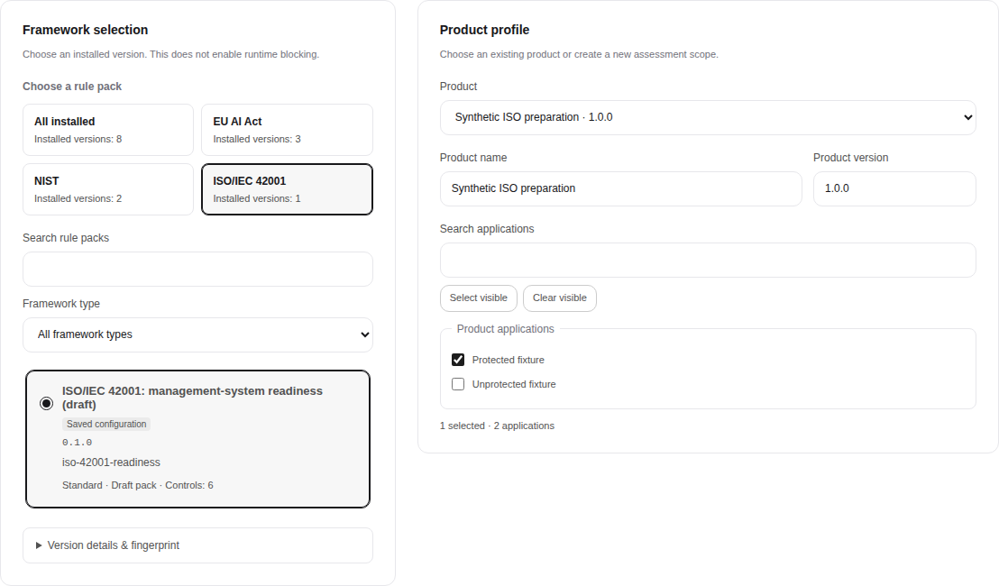

# Run EU AI Act, NIST and ISO/IEC 42001 preparation workflows

**English** | [简体中文](zh-CN/framework-workflows.md)

GovWeave connects a versioned framework checklist to **application scope → evidence → assessment → remediation → verification → retained report replay**. The six-pack `eu-nist-iso-starter/2026.11.15` bundle makes this workflow reproducible locally. Packs are optional; a framework shortcut in the console does not mean its packs are installed.

## What each framework covers

| Framework | Installed pack IDs (all version `0.1.0`) | Implemented scope |
| --- | --- | --- |
| EU AI Act | `eu-ai-act-chatbot-transparency`, `eu-ai-act-high-risk-readiness`, `eu-ai-act-gpai` | Selected interaction-notice evidence, high-risk preparation records and GPAI documentation references; applicability and interpretive judgments remain manual |
| NIST AI RMF / GenAI Profile | `nist-ai-rmf-lifecycle`, `nist-genai-profile` | Versioned pre-deployment/operation tests, selected GenAI assessment and document references; no complete GOVERN/MAP/MEASURE/MANAGE coverage |
| ISO/IEC 42001:2023 | `iso-42001-readiness` | A GovWeave preparation checklist for scope/inventory, responsibilities, risk treatment and improvement records; public-overview basis only, no licensed clause or Annex A mapping |

The [European Commission](https://digital-strategy.ec.europa.eu/en/policies/regulatory-framework-ai) describes the AI Act's risk-based regulatory approach. [NIST](https://www.nist.gov/itl/ai-risk-management-framework) presents AI RMF as a voluntary risk-management framework, with a separate [GenAI Profile](https://www.nist.gov/publications/artificial-intelligence-risk-management-framework-generative-artificial-intelligence). [ISO's public overview](https://www.iso.org/standard/42001) describes an organizational AI management system. These are different kinds of frameworks, not interchangeable certifications. Public sources were checked on 2026-11-15; existing immutable EU/NIST packs retain their own earlier source dates and versions.

**The workflow can complete while manual controls remain unknown.** Passing a reference-availability check means the submitted fact satisfies that predicate, not that GovWeave read the document or approved its sufficiency. ISO preparation is scoped to a product and its applications in this release; it is not an organization-wide conformity assessment. Detailed ISO mapping needs licensed standard materials and qualified review.

## One-command local acceptance

From a source checkout with Go 1.24+, Python 3.10+ and Make:

```sh
make demo-frameworks
# Chinese terminal summary:
make demo-frameworks DEMO_LANG=zh-CN
```

This builds and starts a temporary gateway and a scripted local model. It loads only the six pinned packs from `examples/compliance-bundles/eu-nist-iso.json`. No external account, provider key, paid inference or production data is used. The manifest is not itself a rule pack.

For every pack, the script verifies missing evidence, a known gap, a remediation record, a fresh verification, report replay and invalidation after evidence changes. NIST lifecycle facts come from actual HTTP calls to the local scripted model, including intentional failures and repair; other document/assessment facts are explicitly synthetic references. All human-review controls remain unknown even when a reference claims review occurred.

Expected final snapshot counts:

| Pack | Pass | Fail | Unknown / manual | Not applicable |
| --- | ---: | ---: | ---: | ---: |
| EU interaction transparency | 3 | 0 | 3 | 0 |
| EU high-risk readiness | 3 | 0 | 2 | 0 |
| EU GPAI | 3 | 0 | 2 | 0 |
| NIST lifecycle | 3 | 0 | 5 | 0 |
| NIST GenAI | 3 | 0 | 2 | 0 |
| ISO 42001 preparation | 4 | 0 | 2 | 0 |

These are synthetic workflow acceptance counts, not an organization's compliance score. Reports are written privately to a new `dist/framework-demo/<run>/` directory: one JSON per pack, plus `summary.json`. Each pack file contains the original gap, verified remediation, retained report, replay result and later stale state. Services and temporary state are removed on exit. The saved verified snapshot is intentionally historical after the final evidence-change scenario.

To use an existing binary or choose a new output directory:

```sh
python3 scripts/demo-frameworks.py --binary ./bin/govweave --output-dir dist/my-framework-run
```

An existing output directory is rejected. Failures exit nonzero; partial output must not be presented as completed acceptance.



Actual isolated browser-test capture. Names and counts are synthetic; the two extra installed versions belong to internal test fixtures. [Screenshot provenance](screenshots/README.md).

## Install and use in the console

1. Run the local demo above to validate the bundled definitions. For an existing deployment, back up its data and preserve all existing immutable pack versions. Copy the six **pack files listed in the manifest** into the deployment's `rule-packs/` directory with the service's ownership and private permissions. Reject different contents for an existing ID/version. Do not copy the manifest or synthetic reports into that directory. Restart the single service to load the merged catalog; invalid definitions prevent startup. See [deployment](deployment.md) and [pack installation](eu-us-compliance-bundle.md#rule-pack-regression-and-installation).
2. Open **Plugin center → Frameworks & rule packs**. The **EU AI Act**, **NIST** and **ISO/IEC 42001** shortcuts filter installed versions and display their counts. Zero means nothing in that family is installed. Choose a pinned version and inspect **Rule pack coverage and sources**.
3. Use **Bind applications** to name the product, specify its release and select applications. Currently each product has one pack. To assess the same application under several packs, create separately named product profiles; do not replace the pack on an existing finding to close it.
4. Use **Add evidence** to expand required facts. Explicitly include a reference, choose its value and source, and provide an evidence ID plus observation time (`2026-11-15T09:00:00Z` format). Optional expiry must follow observation time. IDs use letters, digits, `.`, `_`, `-`, start with a letter/digit and are at most 100 characters. An unchecked fact is absent; **No** is a supplied negative fact. Use your actual references and timestamps. The form does not upload files, open references or verify authors. Existing unrelated facts are preserved. `runtime.*` and `testing.*` entries are read-only and are collected by the server.
5. **Save product and rule pack**, then **Assess and remediate → Evaluate saved product**. Unsaved changes disable assessment and hide old results. Inspect failed or unknown controls, their evidence issues and next actions. Language changes preserve drafts; switching products or reloading prompts before discarding them. Revision conflicts do not silently overwrite another change.
6. Select **Track remediation**, record the owner and intended fix, and make the actual evidence/configuration changes. Mark it ready for recheck, explicitly run any needed test, then verify. Manual review controls cannot be closed by a true boolean. See [remediation](remediation.md) for scope binding, retest freshness, event history and stale verification.

For NIST lifecycle product reports, configure exactly one model or read-tool test plan and run its pre-deployment and operation phases. The latest comparable run per phase supplies lifecycle facts; a failed run replaces pass with fail, and an incomplete run removes the old verdict. Product, plan, suite or configuration changes invalidate the association. Multiple plans leave the unqualified lifecycle facts unknown; target-specific output facts remain separate. Operation evidence expires after twice the plan interval, pre-deployment evidence after 30 days. Those are local assurance choices, not NIST mandates. See [active assessment](active-assessments.md).

The ISO evidence editor requests `scope.aims_in_scope` (assessment source) and `aims.*` document references. `AIMS-SCOPE` and `AIMS-ADEQUACY` always require human judgment when applicable. Its four automatic checks only examine reference-availability facts, with a local 30-day freshness bound. Missing, expired or wrong-source facts do not pass.

## Retain and replay the result

Remediation creation and verification retain reports automatically. For a separate report, use the [admin CLI](admin-cli.md), after logging in with a reusable session. Here `gw` is the documented shell function and IDs must be replaced with returned values:

```sh
gw reports create --product PRODUCT_ID
gw reports show --id REPORT_ID
```

Replay is available through the administrator API: `POST /api/v1/compliance/reports/{report}/replay` with an empty JSON object and the normal mutation headers. The local demo exercises this API automatically.

Reports pin the product revision, rule-pack definition/fingerprint, evidence input and evaluation time. Replay checks the saved decision without calling a model or asserting that the evidence is still current. Reports do not constitute a certificate or deployment approval.

Verification: `make check`, `go test -race ./...`, `make demo-frameworks`, and `node tests/plugins-smoke.cjs` (Playwright/Chrome required). The browser test covers family filtering, evidence save and validation, negative facts, manual-review boundaries, draft/language preservation, read-only test facts, logout cleanup and mobile layout alongside existing plugin workflows.
