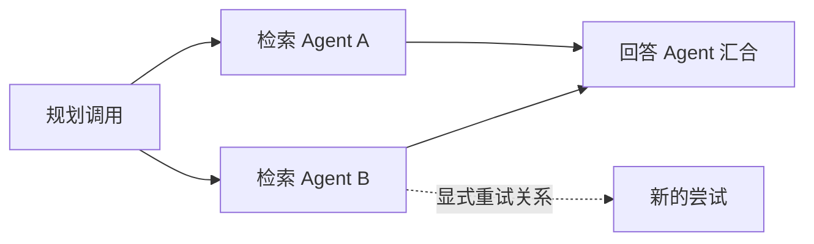

# 异构多 Agent 任务追踪

[English](../agent-tracing.md) | **简体中文**

GovWeave 将模型调用、读取工具调用和独立内容检测关联到按应用隔离的 trace。不同 Agent 框架、语言和服务可以传递同一关联 ID，同时保持各自的模型权限和资源授权。这里记录的是实际经过网关的调用图，不是 Agent 执行引擎，也不能证明业务任务正确完成。

应用接口只返回当前应用自己的片段。管理员可以显式选择参与应用，查看合并结果。仅知道某个 trace ID，或发送与另一应用相同的 ID，都不会获得其记录访问权。

需要结合留存证据调查时，可使用独立的[跨应用任务证据视图](risk-evidence.md#跨应用任务证据)，合并加密保险库元数据与近期审计调用。它显示证据可用性和已记录的发现，仍要求管理员明确选择应用，并保留历史不完整的边界。

## 关联请求头

在 `POST /v1/chat/completions`、`POST /v1/tools/{alias}/invoke` 和 `POST /v1/content/evaluations` 中，通过以下 HTTP 请求头显式开启追踪。标识符必须是小写、非全零的十六进制值，不要放入姓名、正文或密钥。

| 请求头 | 值与用途 |
| --- | --- |
| `X-GovWeave-Trace-ID` | 32 位十六进制任务关联 ID。使用任何辅助头时必填。 |
| `X-GovWeave-Parent-Span-ID` | 可选的 16 位主要前序节点引用。 |
| `X-GovWeave-Agent-ID` | 可选的 16 位调用方声明的 Agent 标签，不是认证身份。 |
| `X-GovWeave-Link-Span-IDs` | 可选，以逗号分隔且不含空格的最多四个不重复 16 位引用，用于汇合或其他依赖。 |
| `X-GovWeave-Retry-Of` | 可选的 16 位前次尝试引用，不会让网关自动重试。 |

重复头、格式错误、全零 ID，以及缺少 trace ID 的辅助字段，返回 `400 invalid_trace_context`。请求不得设置 `X-GovWeave-Span-ID`，该字段保留给服务器响应。未携带这些请求头的调用保持原行为。网关不会将这些字段转发给模型或工具提供方；关联字段不能改变应用鉴权、资源授权、策略范围、审计准入和输出释放检查。

服务器无法生成 span ID 时，在执行上游请求前返回 `503 trace_unavailable`。

每次关联调用由服务器生成新的 `span_id`，并返回 `X-GovWeave-Trace-ID` 和 `X-GovWeave-Span-ID`。调用方可将返回的 span ID 用于后续父节点、汇合或重试引用。持久化的 `CallRecord.trace` 使用 `agent-trace-v1`，包含 `trace_id`、`span_id`，以及调用方提供的 `parent_span_id`、`agent_id`、`links` 和 `retry_of_span_id`。网关验证应用身份并观察实际调用、策略结果，不会独立验证 Agent 标签或其声称的因果关系。

返回标识只表示关联已分配，不保证终态审计记录已持久化，也不保证整项任务完成。发生故障时，应检查请求结果与可见审计记录。

32／16 位标识符宽度参考 [W3C Trace Context 的标识符定义](https://www.w3.org/TR/trace-context/#traceparent-header-field-values)。这是 GovWeave 自有请求头和校验契约，并非 W3C `traceparent`／`tracestate` 协议实现或 OpenTelemetry 导出器。

## 并行、交接与重试

编排器在任务开始前创建随机 trace ID，并明确传递给参与后端。每个后端继续使用自己的应用密钥。Agent 标签可区分规划、检索和回答工作者，但不会授予其他工作者的权限。



主要前序节点使用 parent，其他依赖使用 `links`。并行调用即使共享父节点，也拥有不同的服务器 span ID。重试是新的 HTTP 调用和新节点；`retry_of_span_id` 保留与前次尝试的关系，不覆盖历史。网关不自动重试，也不编排 Agent 调度。

只有经过此网关的调用才显示为节点。本地推理、框架内部步骤、队列交付及绕过 GovWeave 的调用不会被上传或推断出来，对它们的引用可能无法解析。不同服务的到达顺序和时钟时间不能直接证明因果关系。

## 显式启用 Python 参考客户端追踪

先将 `examples/python` 加入导入路径，例如设置 `PYTHONPATH=examples/python`。对已配置的 HTTPS 网关，将 `GOVWEAVE_ROOT` 设为不含 `/v1` 的实例根地址，`GOVWEAVE_API_KEY` 设为应用密钥，`GOVWEAVE_TOOL_ALIAS` 设为已授权只读工具。单次追踪调用使用不可变且显式传入的上下文：

```python
import os
from govweave_tools import GovernedToolClient
from govweave_tracing import TraceContext, invoke_traced_tool

root = os.environ["GOVWEAVE_ROOT"]
key = os.environ["GOVWEAVE_API_KEY"]
tool_alias = os.environ["GOVWEAVE_TOOL_ALIAS"]
client = GovernedToolClient(root, key, tool_alias)
context = TraceContext.new()
outcome = invoke_traced_tool(client, {"resource_id": "public-guide"}, context)
print(outcome.metadata())
```

资源 ID 应与应用配置一致。`metadata()` 不包含返回内容；目标应用检查 `outcome.status` 后可使用 `outcome.text`。被拒绝的调用也可能带有服务器 span ID。存在 `outcome.span_id` 时，`context.after(outcome.span_id)` 可创建后续上下文，原对象不会改变。汇合时传 `links=(span_a, span_b)`，显式声明重试关系时传 `retry_of_span_id=previous_span`；两者都不会自动发起请求。

基础 [KnowledgeAgent 参考实现](knowledge-agent.md) 也有显式启用的包装函数。复用上面的 `root`、`key`、`tool_alias`，并配置已授权的 `GOVWEAVE_MODEL_ALIAS` 后，可为另一项任务执行：

```python
from govweave_agent import KnowledgeAgent
from govweave_tracing import run_traced_agent

agent = KnowledgeAgent(
    root, key, os.environ["GOVWEAVE_MODEL_ALIAS"], tool_alias,
    {"public-guide": "Support hours and account recovery instructions"},
)
result = run_traced_agent(agent, "What are the support hours?", TraceContext.new())
print(result.metadata())
```

`run_traced_agent` 只接受基础 `KnowledgeAgent` 类。每次运行分别复制参考 Agent 和工具对象，再将响应 span ID 沿该次运行的串行模型 → 工具 → 模型调用传递。入口 `links` 与 `retry_of_span_id` 只用于第一次调用，后续调用引用前一次 span。原有 `run(question)` 和 `execute(arguments)` 接口不变。该辅助模块不是框架插件，也不为任意 Agent 子类提供自动插桩。

`python3 tests/trace-client-test.py` 使用模拟网关响应检查这条显式启用的调用链，包括工具被拒绝后停止，以及并行运行之间的上下文隔离。下方跨进程演示验证的是工具路径，不会运行真实的模型 → 工具 → 模型工作流。

## 应用与管理员查询

| 接口 | 身份和范围 |
| --- | --- |
| `GET /v1/traces/{trace_id}?limit=100` | 使用当前有效的应用密钥，仅查询本应用记录。 |
| `GET /api/v1/traces/{trace_id}?application_id=A&application_id=B&limit=100` | 使用管理员会话，必须显式选择一至十六个应用 ID。 |

返回数量限制为 1–128，默认 100。管理员选择的应用 ID 必须互不重复且已登记。撤销或轮换失效的应用密钥不能查询。管理员选择只是基于管理员权限的查看操作，不会给应用新增协作授权，也不会建立持久化共享关系。

无效查询字段返回 `400 invalid_trace_query`，应用鉴权失效返回 `401`。没有可见记录时统一返回 `404 trace_not_found`，不区分任务不存在、记录已移出窗口或属于另一应用。

引用只在当前选定且可见的响应窗口内解析。窗口外的引用保持未解析，不会补查其他应用来透露该 ID 是否存在。即使两个节点都可见，关系仍标为 `caller_declared`。相同 ID 或可解析的边，不是独立验证的服务协作证据。

每条边的 `source_span_id` 是当前调用，`target_span_id` 是被引用的前序／依赖节点。`relation` 为 `parent`、`link` 或 `retry_of`。`resolution: observed` 仅表示返回视图内有一个对应节点，`unresolved` 表示没有可见节点，`ambiguous` 表示多个节点使用同一 ID。查询不会递归追踪引用，也不会宣称调用方提供的关系构成有效因果 DAG。

响应包含所选 `application_ids`、调用记录、关系和固定风险观察。策略版本与请求 ID 可关联到已有[策略历史](runtime-policies.md)和[工具治理证据](tool-governance.md)。每项风险事件仅包含 `request_id`、`span_id`、`control`、`result` 和 `reason`。控制类型为 `authorization`、`credential_egress`、`sensitive_output`、`tool_credentials` 和 `tool_instruction`；保留原策略结果，不另造综合分数。

独立的 `content.evaluate` 记录表示内容评估，不是实际执行的阻断或已经完成的脱敏。判断事件是否证明运行时保护时，应同时查看记录的 `operation`、执行结果和策略字段。风险观察不是校准后的概率，也不构成法律合规结论。

摘要只统计本次返回记录：`completed`、`blocked`、`failed`（含取消／拒绝的调用）、`in_progress`、`incomplete`、`redacted`、`unknown_detection`，以及未解析／歧义引用数。`redacted` 要求调用已完成且策略结果为 `redacted`；`unknown_detection` 只统计明确检查未知的记录，包括尚未结束的检查，不统计所有缺失或关闭的检查。调用完成不证明业务任务成功，这些计数也不是风险覆盖率。

## 覆盖与留存

查询使用现有的**全局最近 1,000 条请求索引**，由所有应用和操作共享；不会扫描全部审计历史，也不会给每个任务独立保留窗口。响应明确提供：

- `coverage: gateway_calls_only` 和 `task_completion: not_determined`。
- `relationship_source: caller_declared`。
- `history_may_be_truncated: true`，即使当前节点没有未解析引用。
- `window_saturated` 描述共享索引窗口，`result_truncated` 描述本次返回数量限制。
- `audit_available` 描述审计当前能否准入并预留新调用容量；无法准入时仍可查询已有记录。

进行中调用、中断调用和窗口外引用都需要结合这些边界解释。查询无法证明所有任务步骤都已上报，没有观察到风险也不等于任务安全。业务任务评分仍属于独立评估。

关联元数据与现有私有审计记录一起保存，重启后在留存索引范围内恢复。不新增提示词、回答、工具参数或任意元数据的留存。追踪沿用持久审计准入和输出释放检查，不允许静默执行无法记录的调用。

## 运行本地异构示例

示例需要 Go、Python 3 和 Node.js。它会启动隔离的网关与本地合成只读工具服务，无需模型 API Key。

```sh
make demo-multi-agent-trace
```

脚本先启动独立的 Python 和 Node Worker 进程，再等待两者返回。两者显式接收同一 trace ID，使用不同应用密钥，并声明相同父节点。后续调用通过 links 汇合两个分支，另一条请求显式声明重试被拒绝的 Node 调用。示例检查：

- 五个互不相同的网关 span：协调调用、两个并行 Worker、汇合和重试。
- 三次已授权读取完成，两次未授权调用在上游执行前被拒绝；重试仍然被拒绝，因为追踪不会改变权限。
- 两个应用分别只能看到自己的三条、两条记录；管理员显式选择两个应用后可看到全部五条。
- 应用视图中的跨应用引用保持 unresolved，在组合视图中才能解析。
- 跨应用查询筛选、使用应用密钥访问管理员端点、撤销密钥后的查询均被拒绝。

成功时，脚本会打印 `dist/multi-agent-trace/` 下的私有报告路径。`report.json` 包含调用元数据和三个视图，`report.md` 说明检查项与限制。可用 `--output-dir` 指定新的输出目录。[Python 上下文辅助模块](../../examples/python/govweave_tracing.py) 和 [Node Worker](../../examples/python/multi_agent_trace_worker.cjs) 展示了无需共享全局上下文的显式传递方式。

2026-10-29 的本机运行通过了这些检查：五个 span、三次上游读取、两次拒绝，以及分别含三条、两条和五条记录的应用/管理员视图。三个实际响应视图也通过了 trace JSON Schema 验证，包括引用的工具/内容契约与时间戳格式检查。生成报告记录了该次运行的二进制与示例源码哈希。

这是使用合成数据的控制与追踪集成检查，不会请求模型，也不能据此证明模型安全、语义检测准确率、真实框架兼容性、因果关系正确性或整项任务的完整覆盖。

## 当前边界

另有[真实框架联调](framework-tracing-trial.md)，验证显式 LangGraph 和 Pydantic AI 适配、序列化异步交接、并发任务与失败路径。它采用本机固定模型决策，仅覆盖工具调用，与上面的 Python/Node 示例分开记录证据边界。

本版不提供 OTLP 收发、框架自动插桩、跨实例汇总、外部 Agent 内部步骤上传、Agent 身份认证或任务完成证明。跨应用完整视图仍仅供管理员查询。字段契约见 [traces.schema.json](../../schemas/traces.schema.json) 与 [OpenAPI](../../api/openapi.yaml)。
