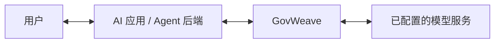

# 通过 GovWeave 接入 AI 应用

[English](../application-onboarding.md) | **简体中文**

将 GovWeave 作为 AI 应用后端或 Agent 的模型 API 入口。先在网关中配置模型提供方，再给每个应用分配独立密钥和模型别名权限；请求与回答经过网关适用的控制。



本指南针对已支持的 Chat Completions 路径。Agent 工具执行需要[单独接入工具治理](tool-governance.md)；只修改模型 URL，无法治理绕过 GovWeave 的数据库、文件或工具调用。

## 启动网关

在源码仓库中准备 Docker 和 Compose，然后执行：

```sh
docker compose build
docker compose up -d --no-build
```

打开 `http://127.0.0.1:8080`。示例 Compose 默认仅绑定回环地址，实例数据保存在命名卷中。首次使用先设置管理员密码。远程访问、HTTPS、备份与恢复见[部署文档](deployment.md)；普通重启不需要删除数据卷。

在“部署与接入”中，将网关根地址设为应用后端可以访问的地址；客户端 BASE URL 在根地址后加 `/v1`。如果应用位于另一个容器，它自己的 `127.0.0.1` 并不指向 GovWeave，需要使用从该容器网络可达的地址。保存公开地址只是配置，不是网络连通性证明。

## 配置模型和应用

1. 在“模型连接”中填写模型提供方 BASE URL、真实模型 ID 和提供方凭证，设置应用使用的服务别名，例如 `internal-assistant`，并启用连接。保留提供方要求的 `/v1` 等路径，不要在保存的 BASE URL 后加 `/chat/completions`。
2. 现有“检查连接”操作只读取提供方模型列表，不进行推理，也不验证应用密钥。
3. 在“应用与密钥”中创建应用，授予该模型连接权限。将一次性展示的应用密钥保存到应用的秘密管理系统或后端环境。
4. 在“部署与接入”中选择该应用，以及它获准使用的启用模型别名。复制 Python 或 cURL 示例和显示的 BASE URL；示例默认使用非流式响应。

管理员密码、应用密钥和模型提供方凭证属于不同身份。应用的 `api_key` 应填写 GovWeave 应用密钥；模型提供方凭证保留在 GovWeave 中，管理员会话只用于管理。

| 应用配置 | 填写内容 |
| --- | --- |
| `base_url` | 网关模型地址，例如 `https://ai.example.com/v1` |
| `api_key` | GovWeave 为该应用签发的密钥 |
| `model` | 已启用并授权给该应用的模型别名 |

`.example` 域名只是占位符。应用与示例 Compose 在同一主机时，本机地址可使用 `http://127.0.0.1:8080/v1`。

## 先检查配置

使用应用密钥调用的配置检查端点是：

```text
GET /v1/integration/check?model=internal-assistant
Authorization: Bearer <application-key>
```

它检查该密钥和别名对应的本机配置：实际鉴权应用 ID、当前模型授权、审计可用性、输入／输出策略模式、是否适用及版本，并报告当前路径是否允许流式调用。已启用且在范围内的输出保护要求使用非流式调用。

响应始终包含 `upstream_contacted: false` 和 `inference: not_tested`。检查不会联系模型提供方、检查提示词、追加调用审计事件或预留容量。HTTP `200` 只表示本机检查成功返回；仍需查看 `audit_available` 和策略字段。策略关闭或不在适用范围内，不能解释为保护已启用。检查之后配置仍可能变化，后续每次调用都会重新校验授权及适用策略。

控制台会将返回的实际应用 ID 与选中的应用比较，再继续验证流程。另一个应用的有效密钥，不能证明当前所选应用已经接入。端点不返回其他应用信息、提供方 URL 或提供方凭证。字段见[接入检查 Schema](../../schemas/integration.schema.json)与 [OpenAPI](../../api/openapi.yaml)。

## 显式发送一次测试并查看证据

控制台的推理验证是独立、显式的操作：使用输入的应用密钥和选定模型别名，发送一条固定合成提示词。这会调用已配置的模型提供方，可能产生费用。页面加载、选择应用和配置检查不会自动推理，也不会自动重试。

用于验证的密钥只临时使用，不写入生成的代码、部署导出或浏览器存储。只在可信的管理员控制台中输入；生产应用密钥应保存在后端，不能放入发送给最终用户的前端代码。

浏览器验证请求发往当前控制台同源地址，不会将密钥发送到任意保存的公开 URL，也不能证明另一个部署环境中的应用能够访问该公开 URL。需要从应用实际运行环境执行复制的示例，才能检查那条网络路径。

先查看推理结果、请求 ID 和追踪标识，再查看选定应用下匹配的管理员审计记录。收到 HTTP 状态或已分配的 span，并不等于终态审计已经持久化。浏览器超时或取消可能发生在上游请求已开始之后；缺失响应证据应保持未知，不能推断调用没有执行。一次调用成功也不证明回答质量、完整 Agent 任务覆盖或法律合规。

验证器展示连接和审计元数据，不保留模型回答。“调用记录”和[追踪 API](agent-tracing.md)说明实际观察到的授权、策略和执行结果。追踪视图只覆盖经过网关的调用，查询范围为全局最近 1,000 条请求索引。

## 在应用代码中使用相同配置

在应用环境中提供以下参数。变量名是客户端约定，不是服务端配置项：

```sh
export GOVWEAVE_BASE_URL='http://127.0.0.1:8080/v1'
export GOVWEAVE_MODEL='internal-assistant'
# 通过后端秘密管理或环境注入 GOVWEAVE_API_KEY。
```

在应用环境安装 OpenAI Python 客户端后：

```python
import os
from openai import OpenAI

client = OpenAI(
    base_url=os.environ["GOVWEAVE_BASE_URL"],
    api_key=os.environ["GOVWEAVE_API_KEY"],
    max_retries=0,
    timeout=30.0,
)
response = client.chat.completions.create(
    model=os.environ["GOVWEAVE_MODEL"],
    messages=[{"role": "user", "content": "Reply with OK."}],
    stream=False,
    max_tokens=16,
)
print(response.choices[0].message.content)
```

此代码会有意在应用输出中显示模型回答；GovWeave 调用审计不保存该回答，控制台验证器也不显示或保存模型正文。协议参考见 [Chat Completions](https://developers.openai.com/api/reference/resources/chat/subresources/completions/methods/create)；本项目支持的子集与提供方限制见[模型接入](model-gateway.md)。

## 检查失败时

| 观察结果 | 后续操作 |
| --- | --- |
| 应用密钥无效、已撤销或已轮换 | 使用当前应用密钥；不能用管理员凭证替代。 |
| 密钥属于另一个应用 | 在推理前选择目标应用，或提供它自己的密钥。 |
| 模型未授权或连接停用 | 核对别名、应用授权和连接状态。 |
| 审计不可用 | 先恢复私有存储访问或处理记录容量，再发起新调用。 |
| 输入／输出策略关闭或不在范围内 | 核对希望启用的保护与范围；访问成功不会自动启用策略。 |
| 上游超时、响应无效或服务不可达 | 核对提供方配置，使用请求 ID 查看已发生的尝试。 |
| 没有匹配的已结束审计记录 | 保持审计确认未知，刷新证据，不自动重发推理。 |

配置检查与一次合成推理属于接入证据，不能代替[应用测评](application-assessments.md)、检测器测量或使用应用自身场景进行的测试。
