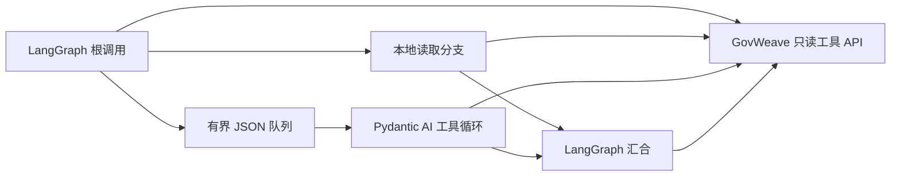

# LangGraph 与 Pydantic AI 追踪联调

[English](../framework-tracing-trial.md) | **简体中文**

这项可选本机联调通过两个已安装的 Agent 框架验证 GovWeave 追踪传递：LangGraph 协调任务，Pydantic AI Agent 执行被委派的只读工具步骤。隔离的网关与可控本地工具服务用于检查异步交接、并发任务、显式重试、超时、取消和权限隔离。

框架实际执行图调度和 Agent 机制。模型决策由本地 Python 函数固定提供，消息桥是在同一 Python 进程内运行的有界 JSON 队列。这是框架接入联调，不是真实模型测评、分布式消息中间件测试，也不意味着两个框架的全部功能均已兼容。

## 实际运行的组件

[框架适配示例](../../examples/python/govweave_frameworks.py)使用编译后的 LangGraph `StateGraph`：根调用启动本地分支和委派分支，之后的汇合步骤记录两个分支返回的 span。LangGraph 图 API 支持这种状态、节点组合和异步执行；并行节点返回的先后顺序不能作为因果顺序。见官方[图 API 概述](https://docs.langchain.com/oss/python/langgraph/graph-api)和[并行执行指南](https://docs.langchain.com/oss/python/langgraph/use-graph-api#run-graph-nodes-in-parallel)。

被委派的执行器使用 Pydantic AI 的 `Agent` 与 `FunctionModel` 运行固定工具调用循环。`FunctionModel` 由本地函数控制，使本次联调能够验证框架的工具处理流程而不请求外部 LLM。Pydantic 官方的 [FunctionModel 说明](https://pydantic.dev/docs/ai/api/models/function/)和[测试指南](https://pydantic.dev/docs/ai/guides/testing/)区分了这类控制流程测试与模型质量评估。



每项任务使用显式、不可变的追踪上下文。队列传递有界标识和选定的合成资源，不传递其他执行器的应用密钥；两个框架各自使用配置好的应用身份。网关调用沿用已有的[追踪头与查询权限](agent-tracing.md)，框架内部步骤和队列操作不会自动成为网关 span。

适配示例关闭可选框架遥测，不保存检查点，也不缓存中间图状态。只有工具 HTTP 调用经过 GovWeave；本地 `FunctionModel` 决策不是经过网关的模型调用。

HTTP 路径直接使用异步 HTTPX，使取消任务能够关闭执行中的连接。把同步参考客户端包在 `asyncio.to_thread` 中不能证明这一点：取消等待协程不会终止已经运行的线程。本次联调的 HTTP 和框架路径关闭自动重试；唯一的重试场景显式发起新调用，并生成新的网关 span。

## 复现联调

依赖快照使用 Python **3.12.9**、`langgraph==1.2.18` 和 `pydantic-ai-slim==2.63.0`。[requirements 文件](../../examples/python/framework-trace-requirements.txt)固定了完整解析依赖。这些是本次联调选择的版本，不是完整支持版本表。框架包只属于可选开发依赖，Go 网关运行时不需要它们。

在仓库根目录创建隔离环境并安装固定依赖：

```sh
python3.12 -m venv /tmp/govweave-framework-trace-venv
/tmp/govweave-framework-trace-venv/bin/python -m pip install -r examples/python/framework-trace-requirements.txt
make trial-framework-trace FRAMEWORK_PYTHON=/tmp/govweave-framework-trace-venv/bin/python
```

make 目标会编译 GovWeave 并运行 [trial-framework-trace.py](../../scripts/trial-framework-trace.py)，不会安装 Python 依赖。`FRAMEWORK_PYTHON` 默认是 `python3`，应选择装有固定依赖的解释器。安装阶段可能需要下载依赖；联调运行本身使用本地服务，无需模型 API Key。

运行器会打印 `dist/framework-trace/` 下的报告路径。直接运行脚本时，可用 `--binary` 指定网关程序，用 `--output-dir` 指定新的报告目录。只有全部计划检查通过且没有记录致命错误时，退出码才为零；只要输出目录可写，失败或不完整的运行也会保留报告。

异步客户端、框架适配器和联调清理逻辑还有独立的定向检查，和 HTTP 集成联调分开运行：

```sh
/tmp/govweave-framework-trace-venv/bin/python tests/async-trace-client-test.py
/tmp/govweave-framework-trace-venv/bin/python tests/framework-adapters-test.py
/tmp/govweave-framework-trace-venv/bin/python tests/framework-trial-test.py
```

联调检查还覆盖满队列关闭、取消等待提交、失败后等待其他并行任务清理，以及失败运行保留计划分母并撤下不安全证据。

## 计划检查项

联调保留固定计划，避免失败后悄然缩小统计分母。九类场景如下：

| 场景 | 必须观察到的结果 |
| --- | --- |
| 正常异步交接 | 实际 LangGraph 分支和 Pydantic AI 执行器共用任务 trace，汇合引用各分支返回的独立 span。 |
| 三项并发任务 | 复用框架与客户端对象时，三项任务的 trace ID、回执和引用不互相混入。 |
| 网关超时与显式重试一次 | 首次请求收到网关超时；重试生成新 span 并引用原尝试，工具实际进入次数与声明的尝试一致。 |
| 客户端截止时间到达且未收到回执 | 客户端可能在响应头返回前超时；报告区分缺失的客户端回执和之后可查询到的网关记录。 |
| 排队期间取消 | 被取消的排队工作不产生工具 I/O。这是测试执行器观察到的事实，不是网关对未上报步骤的推断。 |
| 进入上游后取消 | 先通过模拟服务的同步屏障确认上游已收到，再由调用方取消；保留的网关记录仍说明上游执行已被尝试。 |
| 缺失父节点引用 | 不存在的已声明前置步骤保持 `unresolved`，响应不构造虚假节点，也不声称完整覆盖任务。 |
| 治理拒绝 | 被拒绝的调用停止，不直接绕过网关读取工具，也不自动重试。 |
| 查询权限与撤销 | 应用查询限于自身；管理员聚合须显式选择应用；应用密钥撤销后无法查询追踪。 |

错误、缺失观察和未执行检查须保留在报告的失败／未知结果中。超时或取消场景通过，只代表预期故障得到了准确记录，不代表被中断的业务任务成功。

## 如何理解证据

联调报告只保存元数据，目录权限为 `0700`、文件权限为 `0600`，保留计划以及通过、失败和未知数量，并记录精确依赖版本及源码／二进制哈希。报告不应包含提示词、工具正文、凭证、原始异常消息或请求正文。除了汇总结果，还应检查每个场景的证据。

客户端取消不等于回滚。取消前本地服务可能已经收到请求；取消不能证明服务已停止工作或没有产生副作用。同样，未收到响应回执不代表网关没有收到请求。模拟服务的进入屏障与网关审计是两种独立观察。

`parent_span_id` 表示主要的已声明前置步骤，`links` 表示其他依赖，`retry_of_span_id` 指向先前尝试。标识匹配后，关系仍属于调用方声明。图状态回滚或框架异常不会抹掉已经执行的 HTTP 调用及其审计记录。

追踪查询沿用网关限制：全局最近 1,000 条请求索引、单次最多返回 128 条记录、`coverage: gateway_calls_only`、`relationship_source: caller_declared` 和 `task_completion: not_determined`。缺失引用属于覆盖缺口，与表示已执行检测器结果未知的 `unknown_detection` 不同。没有被上报、也没有声明引用的工作，无法仅凭追踪自动发现。

## 已记录结果

**2026-10-29** 的本机运行完成九项计划检查，**通过 9、失败 0、未知 0**。运行使用 Python 3.12.9、LangGraph 1.2.18、Pydantic AI slim 2.63.0 和 HTTPX 0.28.1。对各场景证据中保存的网关记录去重后，得到：

| 观察结果 | 数量 |
| --- | --- |
| 独立网关请求／span 记录 | 22 |
| 完成的调用（`200`） | 18 |
| 网关上游超时（`504`） | 1 |
| 网关观察到的调用方取消（`499`） | 2 |
| 上游执行前的治理拒绝（`403`） | 1 |
| 模拟上游进入次数，包含超时和取消调用 | 21 |

两条取消记录分别对应客户端截止时间到达和进入上游后的显式取消。独立的排队取消场景没有产生网关记录或上游进入。缺失父节点场景保留了 unresolved 引用以及未知的前置步骤观察；这个预期未知与汇总中“没有未验证检查”是不同概念。可见调用关系仍然属于调用方声明。

模拟服务字段 `upstream_requests_observed` 统计请求进入次数，不表示完成的读取次数，也不表示副作用已经回滚。

更早一次运行保留了通过两项、失败七项的报告。当时模拟服务错误地拒绝了网关生成的 `X-GovWeave-Request-ID` 头；随后修正模拟服务，只禁止调用方追踪头并允许这个网关头。早期失败报告仍保留，这七个失败断言不能解释为七个网关缺陷。

这项联调不证明语义风险检测准确率、模型回答质量、法律合规、任务完整性、生产吞吐量、跨机器队列行为、持久化工作流恢复或任意框架插件兼容性。[之前的 Python/Node 进程示例](agent-tracing.md#运行本地异构示例)仍是独立的运行时上下文传递检查。
