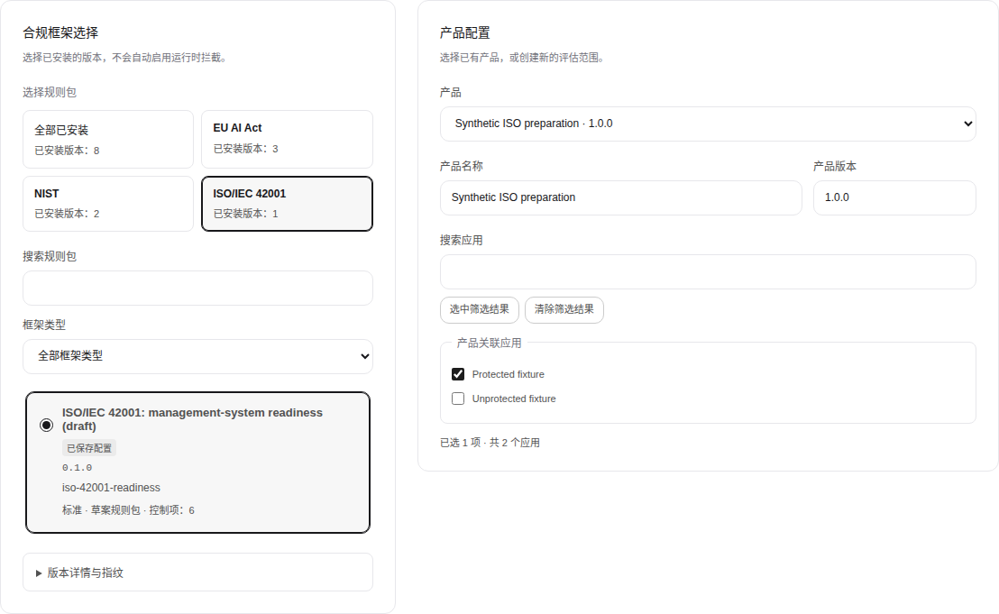

# 跑通 EU AI Act、NIST 与 ISO/IEC 42001 准备流程

[English](../framework-workflows.md) | **简体中文**

GovWeave 将固定版本的框架清单连接到 **应用范围 → 证据 → 评估 → 整改 → 验证 → 历史报告回放**。`eu-nist-iso-starter/2026.11.15` 包含六个规则包，可以在本机复现完整流程。规则包须显式安装；页面出现框架快捷入口，不代表对应规则包已经安装。

## 三类框架分别覆盖什么

| 框架 | 规则包 ID（均为 `0.1.0`） | 已实现范围 |
| --- | --- | --- |
| EU AI Act | `eu-ai-act-chatbot-transparency`、`eu-ai-act-high-risk-readiness`、`eu-ai-act-gpai` | 部分交互告知证据、高风险准备材料及 GPAI 文档引用；适用性和解释性判断保留人工审核 |
| NIST AI RMF／GenAI Profile | `nist-ai-rmf-lifecycle`、`nist-genai-profile` | 版本化部署前／运行期测评、部分生成式 AI 评估与文档引用；不完整覆盖 GOVERN／MAP／MEASURE／MANAGE |
| ISO/IEC 42001:2023 | `iso-42001-readiness` | GovWeave 自定义的范围／清单、责任、风险处置和改进记录准备清单；仅依据公开概述，没有授权条款或附录 A 映射 |

[欧委会](https://digital-strategy.ec.europa.eu/en/policies/regulatory-framework-ai)介绍了 AI Act 按风险分类的监管方式。[NIST](https://www.nist.gov/itl/ai-risk-management-framework)将 AI RMF 定位为自愿风险管理框架，并发布独立的[生成式 AI Profile](https://www.nist.gov/publications/artificial-intelligence-risk-management-framework-generative-artificial-intelligence)。[ISO 公开概述](https://www.iso.org/standard/42001)介绍的是组织层面的 AI 管理体系。它们性质不同，不能互相替代为认证。公开资料核对日期为 2026-11-15；已有不可变 EU／NIST 包保留各自原来源日期和版本。

**流程跑通时，人工审核项仍可保持未知。** 引用可用性检查通过，只表示提交的事实满足该检查，不表示 GovWeave 阅读过文档或批准了材料充分性。本版 ISO 准备度以产品和关联应用为范围，不是组织级符合性审核；详细映射需要授权标准材料和合格人员审核。

## 一条命令本机验收

在源码根目录，准备 Go 1.24+、Python 3.10+ 和 Make：

```sh
make demo-frameworks DEMO_LANG=zh-CN
# 英文终端摘要：
make demo-frameworks
```

命令编译并启动临时网关及本机脚本模型，按照 `examples/compliance-bundles/eu-nist-iso.json` 加载六个固定版本。无需外部账号、提供者密钥、付费推理或生产数据。清单本身不是规则包。

每个包都会验证：材料缺失、已知缺口、建立整改、重新验证、报告回放，以及证据变化后的状态失效。NIST 生命周期证据来自对本机脚本模型的真实 HTTP 调用，包含故意失败与修复；其他文档／评估事实是明确标记的合成引用。即使引用声称已审核，人工控制项也保持未知。

最终验证快照的预期数量：

| 规则包 | 通过 | 失败 | 未知／人工审核 | 不适用 |
| --- | ---: | ---: | ---: | ---: |
| EU 交互透明度 | 3 | 0 | 3 | 0 |
| EU 高风险准备度 | 3 | 0 | 2 | 0 |
| EU GPAI | 3 | 0 | 2 | 0 |
| NIST 生命周期 | 3 | 0 | 5 | 0 |
| NIST GenAI | 3 | 0 | 2 | 0 |
| ISO 42001 准备度 | 4 | 0 | 2 | 0 |

这些是合成流程验收数量，不是某个组织的合规分数。报告以私有权限写入新建的 `dist/framework-demo/<run>/`：每包一个 JSON，另有 `summary.json`。每包文件包含原始缺口、已验证整改、归档报告、回放结果和后续陈旧状态。退出后清理临时服务与数据。最后一步故意改变证据，因此此前的已验证快照只代表历史。

使用已有二进制或指定新输出目录：

```sh
python3 scripts/demo-frameworks.py --binary ./bin/govweave --output-dir dist/my-framework-run --lang zh-CN
```

已存在的输出目录会被拒绝。失败时退出码非零，不能把部分输出当作整体验收完成。



实际隔离浏览器测试截图。名称和数量均为合成示例，多出的两个已安装版本来自内部测试夹具。[截图来源](screenshots.md)。

## 安装并在控制台操作

1. 先运行本机演示验证随附规则定义。已有部署须备份数据，保留所有旧的不可变版本。将清单列出的六个**规则包文件**按服务属主和私有权限放入部署的 `rule-packs/`；同 ID／版本内容不同必须拒绝。不要复制清单或合成报告。重启单个服务加载合并目录；无效定义会阻止启动。见[部署指南](deployment.md)及[规则包安装](eu-us-compliance-bundle.md#规则包回归与安装)。
2. 打开**插件中心 → 合规框架与规则包**。**EU AI Act、NIST、ISO/IEC 42001** 快捷入口按已安装版本筛选并显示数量；零表示尚未安装这一类包。选择固定版本，查看**规则包覆盖范围与来源**。
3. 通过**绑定应用**填写产品名称、发布版本并选择应用。每个产品目前绑定一个包；同一应用评估多个框架时，分别建立命名清楚的产品档案。不能通过替换问题记录对应的规则包来关闭发现。
4. 通过**补充证据**展开所需事实。明确勾选包含引用，选择值和来源，填写证据 ID、观察时间（如 `2026-11-15T09:00:00Z`），可选到期时间须晚于观察时间。ID 以字母或数字开头，允许字母、数字、`.`、`_`、`-`，最长 100 字符。未勾选表示缺失，**否**表示已提交的否定事实。请使用真实引用和时间。表单不上传文件、不打开引用、不核验作者；已有无关事实会保留。`runtime.*`／`testing.*` 只读，由服务端采集。
5. **保存产品与规则包**，再点击**评估与整改 → 评估已保存产品**。未保存修改会禁止评估并隐藏旧结果。查看失败／未知项的证据问题和下一步处理建议。语言切换保留草稿，切换产品或重新加载会先提示是否放弃；修订冲突不会静默覆盖其他修改。
6. 点击**跟进整改**，记录负责人及修复安排，实际修改证据或配置。标记待复核，按需显式执行测试，然后验证。人工审核项不能靠一个值为真的布尔字段关闭。范围绑定、复测时效、事件历史及验证失效见[整改指南](remediation.md)。

NIST 生命周期产品报告需要配置**恰好一个**模型或只读工具测试计划，并运行部署前和运行期阶段。每阶段采用最新且来源版本匹配的测试；失败会替换先前通过结果，未完成／未确定的测试不会保留旧结论。产品、计划、测试集或配置变化会使关联失效。多个计划时，无目标限定的生命周期事实保持未知；具体模型／工具输出事实仍独立处理。运行期证据有效期为计划间隔的两倍，部署前为 30 天。这是本地保障策略，不是 NIST 强制期限。见[主动测评](active-assessments.md)。

ISO 表单要求 `scope.aims_in_scope`（评估来源）及 `aims.*` 文档引用。适用时 `AIMS-SCOPE` 和 `AIMS-ADEQUACY` 保留人工判断；四项自动检查仅判断引用可用性事实，采用本地 30 天时效。缺失、过期或来源不符不会通过。

## 留存与回放结果

建立整改和执行验证会自动归档对应报告。需要另存报告时，可以先按[管理 CLI 指南](admin-cli.md)登录并复用会话。下列 `gw` 为文档中的 shell 函数，ID 需替换为实际返回值：

```sh
gw reports create --product PRODUCT_ID
gw reports show --id REPORT_ID
```

回放使用管理员 API：`POST /api/v1/compliance/reports/{report}/replay`，提交空 JSON 对象并携带常规管理写请求头。本机演示会自动验证此接口。

报告固定产品修订、规则定义／指纹、证据输入和评估时间。回放检查历史决定，不调用模型，也不表示证据目前仍有效。报告不构成认证证书或上线批准。

验证入口为 `make check`、`go test -race ./...`、`make demo-frameworks` 和 `node tests/plugins-smoke.cjs`（需 Playwright／Chrome）。浏览器测试在既有插件流程外，覆盖框架筛选、证据保存和校验、否定事实、人工审核边界、草稿与双语保留、只读测试事实、退出清理及移动布局。
