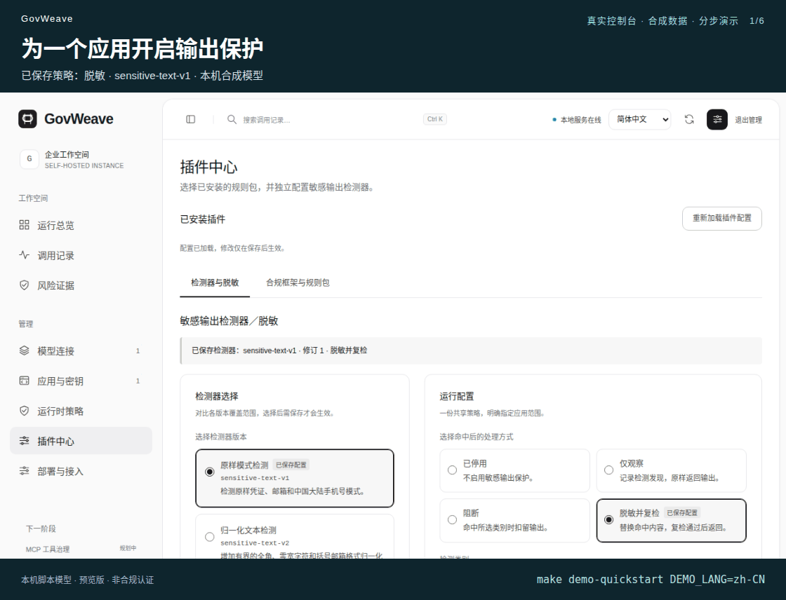

# 60 秒了解 GovWeave

[English](../demo/README.md) | **简体中文**

[亲自运行这个试用](try-it.md) · [接入自己的应用](application-onboarding.md) · [项目首页](../../README.zh-CN.md)



这段循环 GIF 由六幅实际控制台截图和说明组成，每幅停留 10 秒。它是控制节奏的分步演示，不是实时录屏，也不展示性能耗时。不便观看动图时，可以打开下方的静态分镜或阅读文字稿。

## 分镜与解说词

| 时间 | 静态分镜 | 建议解说词 |
| --- | --- | --- |
| 00–10 秒 | [为一个应用开启保护](../demo/zh-CN-01.png) | “这个本机网关已为一个应用开启输出脱敏，使用固定版本的检测器和脚本模型。” |
| 10–20 秒 | [三次请求的结果](../demo/zh-CN-02.png) | “普通回答正常返回，邮箱被脱敏，含凭证的输入被拦截。每次请求都有终态审计记录。” |
| 20–30 秒 | [查看决策依据](../demo/zh-CN-03.png) | “打开邮箱这次调用，可以看到检测结果、处理方式和策略修订，并进一步查看关联证据。” |
| 30–40 秒 | [模型的原始输出](../demo/zh-CN-04.png) | “我们为这个临时应用显式开启了正文采集。管理员可以复核原始合成邮箱，查看操作也会留下审计。” |
| 40–50 秒 | [准备交付的应用输出](../demo/zh-CN-05.png) | “准备返回给应用的内容中，邮箱已替换为脱敏标记。处理前后的输出分别保存，便于复核。” |
| 50–60 秒 | [访问上游前阻断凭证](../demo/zh-CN-06.png) | “含凭证的输入没有到达模型。运行页面下方的一键命令，无需模型账号就能验证这三个场景。” |

## 素材来源与边界

素材于 **2026-11-14** 使用仓库的 `0.2.0-dev` 二进制、[demo-quickstart.py](../../scripts/demo-quickstart.py) 和 [capture-quickstart.cjs](../../scripts/capture-quickstart.cjs) 生成。控制台和 API 返回结果来自真实运行；模型、请求、应用名称及邮箱均为合成内容。标题与页脚加在产品截图之外。截图展示三次请求执行后的状态，不表示这些请求由画面中的控制台操作发出。

生成器核对三条终态审计、两次本机上游调用、输出脱敏、输入阻断、关联证据、两种界面语言及原文访问审计；结束后销毁临时会话。未使用真实提供者账号、生产流量或私有实例内容。正常网关的正文采集默认关闭，本演示只在隔离实例中显式开启。

这三个非流式场景用于介绍接入与控制流程，不代表安全基准、生产性能或法律合规结论。原有[控制台截图](screenshots.md)有独立来源，没有被当作本次流程的运行截图。

## 更新演示素材

普通试用仅需要[试用指南中的前提工具](try-it.md)。**生成素材额外需要 Node、Playwright、Chrome 和 Python Pillow**，并允许本机端口及浏览器运行。按[浏览器测试说明](development.md)准备依赖，让 Node 能找到 Playwright，例如使用开发环境中的 `NODE_PATH`。`GOVWEAVE_BROWSER_PATH` 可指定 Chrome，默认路径为 `/usr/bin/google-chrome`。

编译当前仓库，再选择一个**不存在的**截图目录：

```bash
make build
python3 scripts/demo-quickstart.py --lang zh-CN --capture-dir dist/quickstart-capture-new
```

命令执行相同的三场景试用，为两种语言各生成六幅分镜和一个 60 秒 GIF。命令行仅传递素材路径；临时管理员 Cookie 通过标准输入传给浏览器脚本，不会与应用密钥一起落入截图目录。独立私有元数据摘要保留在 `dist/quickstart/`。

检查全部 PNG 和两个 GIF 后，再将十二个 `en-*.png`／`zh-CN-*.png` 及两个 `quickstart-*.gif` 复制到 `docs/demo/`，并同步更新本页与英文指南的日期。公开目录只保存经过检查的素材，不复制原始报告、凭证或实例数据。
